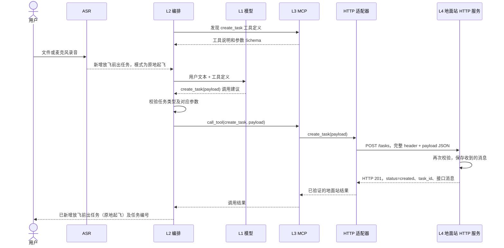

# 四层地面站助手：新增任务 Demo

流程：`录音 → ASR 转写 → LLM 提出调用 → L2 校验 → MCP 工具 → HTTP JSON → 地面站创建任务 → 返回用户`。
也支持跳过 ASR 直接输入文本；L2 在会话启动时发现一次 MCP 工具。

默认使用五条固定口令模拟模型输出、真实 MCP stdio 和独立 HTTP 模拟地面站，只新增本地示例任务。
模拟模式不是 AI 推理；`--local` 切换为本地 oMLX/Ornith。

## 统一接口

项目根目录的 [接口.json](../接口.json) 是请求消息示例，保留原有 `header`，在 `payload` 中定义新增任务。
它不是 JSON Schema，也不是自动更新的任务列表。共享参数模型在 `contracts.py`，MCP SDK 根据模型生成工具 Schema。

```json
{
  "action": "create_task",
  "task": {
    "task_type": "放飞前出任务",
    "parameters": {
      "mode": "原地起飞"
    }
  }
}
```

任务类型和参数严格对应，不接受跨类型混用、未知字段或缺少必填字段：

| task_type | parameters | 必填内容 |
|---|---|---|
| 放飞前出任务 | `mode: 原地起飞` | 无额外参数 |
| 放飞前出任务 | `mode: 在指定位置展开` | `position.longitude`、`position.latitude` |
| 放飞前出任务 | `mode: 在指定区域展开` | `area.vertices`，至少三个不同顶点 |
| 编队飞行任务 | `formation_type: C型` | 无额外参数 |
| 编队飞行任务 | `formation_type: U型` | 无额外参数 |

坐标约定为 WGS84 十进制度：经度 −180 到 180，纬度 −90 到 90；东经、北纬为正。
区域暂用多边形，顶点按边界顺序填写，不重复首点。这里只校验范围和顶点数量/重复，不做完整几何或飞行任务可行性校验。
位置名称、地图选区等上下文尚未接入；缺少坐标时要求澄清，不由模型编造。

指定位置参数示例：

```json
{
  "mode": "在指定位置展开",
  "position": {"longitude": 120.1, "latitude": 30.2}
}
```

指定区域参数示例：

```json
{
  "mode": "在指定区域展开",
  "area": {
    "vertices": [
      {"longitude": 120.1, "latitude": 30.2},
      {"longitude": 120.2, "latitude": 30.2},
      {"longitude": 120.2, "latitude": 30.3}
    ]
  }
}
```

编队任务 payload 示例：

```json
{
  "action": "create_task",
  "task": {
    "task_type": "编队飞行任务",
    "parameters": {"formation_type": "C型"}
  }
}
```

MCP 工具为 `create_task(payload)`，模型输出的调用参数外层是 `{"payload": ...}`。
MCP 工具中的 HTTP 适配器使用 `接口.json` 的消息头组装请求，每次生成新的 `header.msg_id`，其他头字段（包括 `PRE_PLAN`）保留；模板文件不会被运行时改写。
完整的 `{"header": ..., "payload": ...}` 作为 HTTP 请求体发送到 `POST /tasks`，地面站模拟程序再次校验并保存收到的消息。

## 四层对应代码

| 层 | 文件 | 职责 |
|---|---|---|
| L1 模型推理 | `model.py` | 接收文本和工具定义，提出一次新增任务调用 |
| L2 助手编排 | `demo.py` | 校验工具/参数，执行调用，整理实际结果 |
| L3 能力接入 | MCP 客户端 + `server.py` + `gcs_http.py` | 暴露 `create_task`，组装接口消息，通过 HTTP 发送和验证回复 |
| L4 地面站业务与执行 | `gcs_client.py` + `backend.py` | 接收 HTTP JSON，再次校验，保存任务并返回实际结果 |

`contracts.py` 是各层共享的 payload、消息头和返回结果契约，`scenarios.py` 保存五个模拟输入样例。
项目根目录的 `asr.py` 提供共用的模型加载、文件转写和麦克风转写接口。
`gcs_client.py` 是模拟地面站应用的文件名，从 HTTP 角色上它是接收请求的服务端。



缺少参数或无调用时，L2 直接返回澄清/说明。这里不启用 Skills、Jev 或 LangGraph；它们作为后续扩展。

## 安装

```sh
conda activate speech-asr
cd /Users/melonwater/project/LK/SpeechRecognition/demo_gcs_layers
python -m pip install -r requirements.txt
```

使用已有 `speech-asr` 环境。HTTP 服务使用 Python 标准库，不需要额外的 Web 框架。

## 启动地面站 HTTP 模拟程序

在终端1运行：

```sh
conda activate speech-asr
cd /Users/melonwater/project/LK/SpeechRecognition/demo_gcs_layers
python gcs_client.py
```

默认监听 `http://127.0.0.1:18001`，接收到的 JSON 和处理结果会打印在这个终端。

| 接口 | 返回 |
|---|---|
| `GET /health` | HTTP 200，服务健康状态 |
| `POST /tasks` | 合法消息返回 HTTP 201、`status`、`task_id`、原消息 `message`、保存路径 `file` |
| 非法 JSON / 非法任务消息 | HTTP 400 / 422、错误信息，不创建任务 |

可用 `--host`、`--port`、`--output-dir` 修改监听地址和保存位置。
环境变量 `GCS_LAYERS_OUTPUT` 也可以指定保存目录。
任务保存为 `output/TASK-<id>.json`，内容是完整的 `header + payload`。

不经过 ASR/LLM/MCP，直接验证地面站接口：

```sh
curl -i http://127.0.0.1:18001/health
curl -i http://127.0.0.1:18001/tasks \
  -H 'Content-Type: application/json' \
  --data-binary @../接口.json
```

## 文本入口

在终端2运行：

```sh
conda activate speech-asr
cd /Users/melonwater/project/LK/SpeechRecognition/demo_gcs_layers
python demo.py
```

默认口令为 `新增放飞前出任务，模式为原地起飞`。
MCP 服务由客户端用当前 Python 解释器自动启动；任务由独立的地面站 HTTP 服务保存。
每次创建使用新编号，不覆盖旧任务。HTTP 请求不自动重试。
如果地面站改变端口，客户端使用 `--gcs-url http://127.0.0.1:新端口`。

五条模拟口令（允许 ASR 省略标点或空格，但不进行通用语义理解）：

```sh
python demo.py '新增放飞前出任务，模式为原地起飞'
python demo.py '新增放飞前出任务，在指定位置展开，位置为东经120.1度、北纬30.2度'
python demo.py '新增放飞前出任务，在指定区域展开，区域顶点为120.1,30.2；120.2,30.2；120.2,30.3'
python demo.py '新增C型编队飞行任务'
python demo.py '新增U型编队飞行任务'
```

## 本地模型

另开终端启动 oMLX：

```sh
omlx serve --model-dir /Users/melonwater/project/OMLXProject/models --port 18000
```

服务就绪后：

```sh
python demo.py --local '新增一个放飞前出任务，使用原地起飞模式'
python demo.py --local '帮我新增一个U型编队飞行任务'
```

`--url` 和 `--model` 可覆盖默认接口与模型名称。
真实模型收到实际发现的 MCP Schema 和中文任务说明，支持自由表述；模型正确率需要另行测试，模拟测试不能证明实际语义识别准确。

## ASR 文件和麦克风入口

保持地面站 HTTP 服务运行。真实模型模式还需保持 oMLX 服务运行。

使用录音文件：

```sh
python demo.py --file /绝对路径/任务口令.wav --local
```

使用麦克风：

```sh
python demo.py --mic --local
```

模型加载后，按 `e` 开始录音，再按 `e` 结束并识别；按 `q` 退出，无需回车。
每段转写自动进入任务流程，终端展示任务结果后可录下一条。
ASR 模型与 MCP 连接在同一会话中复用；出错会显示原因，然后可以继续录音。
麦克风需要交互式终端及系统录音权限；Ctrl+C 会关闭录音并恢复终端设置。

省略 `--local` 可用固定口令模拟模型验证 ASR→MCP→HTTP 链路。
文本、`--file`、`--mic` 三种输入互斥；`--asr-model-dir` 可覆盖本地 ASR 模型目录。
Paraformer 是整句识别模型，录音结束后才开始转写。

## 验证

```sh
python -m unittest -v test_demo.py
python demo.py '新增编队飞行任务'
```

测试覆盖五种合法任务、模式/编队类型错误、缺少位置、坐标越界、区域顶点不足/重复、混用参数、未知工具及否定/无关输入。
测试启动临时 HTTP 地面站，通过真实 MCP 和 HTTP 验证五种任务、拒绝时不写文件、接口消息和返回值。
ASR 入口测试注入转写结果，验证文件输入和连续麦克风输入进入同一流程，并检查模型只加载一次；这不等于真实麦克风录音验证。

每条输入仍是单次提案流程，澄清回复不自动续接上一条任务；麦克风模式可以连续处理新的口令。
新增任务仅保存到独立模拟地面站，不连接真实飞控，也不启动飞行。
