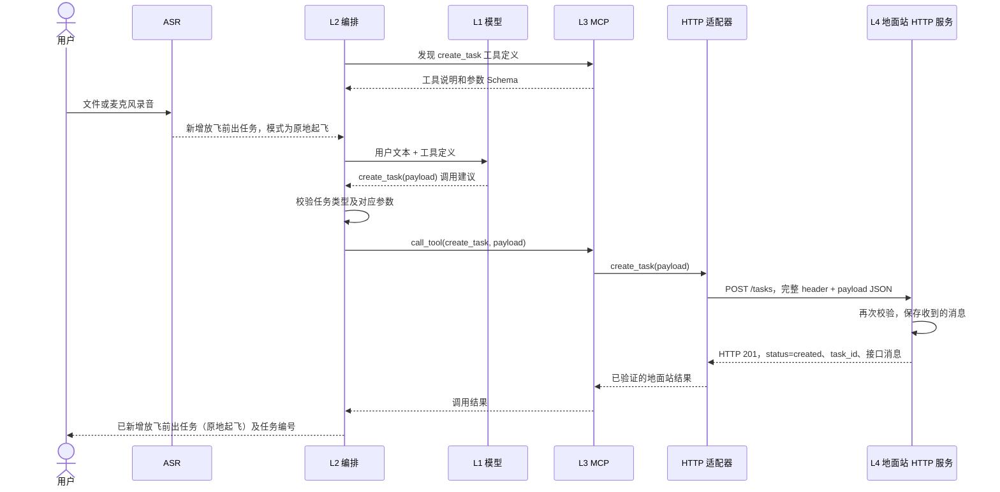

> 历史架构/规划说明：2026-10-16 已改为 React 地面站直接请求 Agent，MCP 在 Agent 侧进行本地任务模拟，结果由 Agent 返回界面。本文保留早期设计，现有实现以 [接口设计](接口设计.md) 和 [地面站对接接口](地面站对接接口.md) 为准。

# 地面站助手框架

流程：`录音 → ASR 转写 → LLM 提出调用 → L2 校验 → MCP 工具 → HTTP JSON → 地面站创建任务 → 返回用户`。
也支持跳过 ASR 直接输入文本；L2 在会话启动时发现一次 MCP 工具。

助手通过本地 oMLX/Ornith 提出调用建议，使用真实 MCP stdio 和独立 HTTP 模拟地面站，只新增本地示例任务。

## 统一接口

项目根目录的 [接口.json](../接口.json) 是请求消息示例，保留原有 `header`，在 `payload` 中定义新增任务。
它不是 JSON Schema，也不是自动更新的任务列表。共享参数模型在 `shared/contracts.py`，MCP SDK 根据模型生成工具 Schema。

```json
{
  "action": "create_task",
  "task": {
    "task_type": "放飞前出任务",
    "parameters": {
      "mode": "原地起飞"
    }
  }
}
```

任务类型和参数严格对应，不接受跨类型混用、未知字段或缺少必填字段：

| task_type | parameters | 必填内容 |
|---|---|---|
| 放飞前出任务 | `mode: 原地起飞` | 无额外参数 |
| 放飞前出任务 | `mode: 在指定位置展开` | `position.longitude`、`position.latitude` |
| 放飞前出任务 | `mode: 在指定区域展开` | `area.vertices`，至少三个不同顶点 |
| 编队飞行任务 | `formation_type: C型` | 无额外参数 |
| 编队飞行任务 | `formation_type: U型` | 无额外参数 |

坐标约定为 WGS84 十进制度：经度 −180 到 180，纬度 −90 到 90；东经、北纬为正。
区域暂用多边形，顶点按边界顺序填写，不重复首点。这里只校验范围和顶点数量/重复，不做完整几何或飞行任务可行性校验。
位置名称、地图选区等上下文尚未接入；缺少坐标时要求澄清，不由模型编造。

指定位置参数示例：

```json
{
  "mode": "在指定位置展开",
  "position": {"longitude": 120.1, "latitude": 30.2}
}
```

指定区域参数示例：

```json
{
  "mode": "在指定区域展开",
  "area": {
    "vertices": [
      {"longitude": 120.1, "latitude": 30.2},
      {"longitude": 120.2, "latitude": 30.2},
      {"longitude": 120.2, "latitude": 30.3}
    ]
  }
}
```

编队任务 payload 示例：

```json
{
  "action": "create_task",
  "task": {
    "task_type": "编队飞行任务",
    "parameters": {"formation_type": "C型"}
  }
}
```

MCP 工具为 `create_task(payload)`，模型输出的调用参数外层是 `{"payload": ...}`。
MCP 工具中的 HTTP 适配器使用 `接口.json` 的消息头组装请求，每次生成新的 `header.msg_id`，其他头字段（包括 `PRE_PLAN`）保留；模板文件不会被运行时改写。
完整的 `{"header": ..., "payload": ...}` 作为 HTTP 请求体发送到 `POST /tasks`，地面站模拟程序再次校验并保存收到的消息。

## 四层对应代码

| 层 | 文件 | 职责 |
|---|---|---|
| L1 模型推理 | `inference/models.py` + `inference/prompts.py` | 接收文本和工具定义，提出一次新增任务调用 |
| L2 助手编排 | `assistant/workflow.py` + `assistant/tools.py` | 校验工具/参数，执行调用，整理实际结果 |
| L3 能力接入 | `integrations/mcp_client.py` + `mcp_server.py` + `gcs_http.py` | 暴露 `create_task`，组装接口消息，通过 HTTP 发送和验证回复 |
| L4 地面站业务与执行 | `simulator/http_server.py` + `simulator/backend.py` | 接收 HTTP JSON，再次校验，保存任务并返回实际结果 |

`shared/contracts.py` 是各层共享的 payload、消息头和返回结果契约。
`inputs/speech.py` 提供内部 ASR 实现，`inputs/sources.py` 统一产出文本流。
`simulator/http_server.py` 是接收 HTTP 请求的地面站模拟服务端。



缺少参数或无调用时，L2 直接返回澄清/说明。这里不启用 Skills、Jev 或 LangGraph；它们作为后续扩展。

## 安装

```sh
conda activate speech-asr
cd /Users/melonwater/project/LK/SpeechRecognition
python -m pip install -r requirements.txt
# 使用录音或麦克风时额外安装
python -m pip install -r requirements-speech.txt
```

使用 Python 3.11+ 和已有 `speech-asr` 环境，以下所有命令均在项目根目录运行。核心依赖与语音依赖分开安装；文本模式不加载 FunASR、Torch 或录音库。模型下载方法见根 README。HTTP 服务使用 Python 标准库。

## 启动地面站 HTTP 模拟程序

在终端1运行：

```sh
conda activate speech-asr
cd /Users/melonwater/project/LK/SpeechRecognition
python main.py gcs
```

默认监听 `http://127.0.0.1:18001`，接收到的 JSON 和处理结果会打印在这个终端。

| 接口 | 返回 |
|---|---|
| `GET /health` | HTTP 200，服务健康状态 |
| `POST /tasks` | 合法消息返回 HTTP 201、`status`、`task_id`、原消息 `message`、保存路径 `file` |
| 非法 JSON / 非法任务消息 | HTTP 400 / 422、错误信息，不创建任务 |

可用 `--host`、`--port`、`--output-dir` 修改监听地址和保存位置。
环境变量 `GCS_LAYERS_OUTPUT` 也可以指定保存目录。
任务保存为 `output/TASK-<id>.json`，内容是完整的 `header + payload`。

不经过 ASR/LLM/MCP，直接验证地面站接口：

```sh
curl -i http://127.0.0.1:18001/health
curl -i http://127.0.0.1:18001/tasks \
  -H 'Content-Type: application/json' \
  --data-binary @接口.json
```

## 文本入口

在终端2运行：

```sh
conda activate speech-asr
cd /Users/melonwater/project/LK/SpeechRecognition
python main.py assistant
```

默认口令为 `新增放飞前出任务，模式为原地起飞`。
MCP 服务由客户端用当前 Python 解释器自动启动；任务由独立的地面站 HTTP 服务保存。
每次创建使用新编号，不覆盖旧任务。HTTP 请求不自动重试。
如果地面站改变端口，客户端使用 `--gcs-url http://127.0.0.1:新端口`。

五条任务口令（交给本地模型解析，语义正确率需实测）：

```sh
python main.py assistant '新增放飞前出任务，模式为原地起飞'
python main.py assistant '新增放飞前出任务，在指定位置展开，位置为东经120.1度、北纬30.2度'
python main.py assistant '新增放飞前出任务，在指定区域展开，区域顶点为120.1,30.2；120.2,30.2；120.2,30.3'
python main.py assistant '新增C型编队飞行任务'
python main.py assistant '新增U型编队飞行任务'
```

## 本地模型

另开终端启动 oMLX：

```sh
/opt/homebrew/opt/omlx/libexec/bin/python scripts/serve_omlx_cached.py \
  --model-dir /Users/melonwater/project/OMLXProject/models --port 18000
```

上述启动适配器针对 oMLX 0.6.3rc2，将 ArraysCache 模型的缓存块和 prefill 分块同时设为 512 token。配合 oMLX 的缓存开关与 2 GiB 热缓存，可复用本项目的固定前缀。适配器有版本校验，未修改第三方安装文件；升级后需重新验证。普通 `omlx serve` 使用上游默认分块。详见 [缓存测试报告](cache-performance.md)。

服务就绪后：

```sh
python main.py assistant '新增一个放飞前出任务，使用原地起飞模式'
python main.py assistant '帮我新增一个U型编队飞行任务'
```

`--url` 和 `--model` 可覆盖默认接口与模型名称。
真实模型收到实际发现的 MCP Schema 和中文任务说明，支持自由表述；模型正确率需要另行测试。

## ASR 文件和麦克风入口

保持地面站 HTTP 服务与 oMLX 服务运行。

使用录音文件：

```sh
python main.py assistant --file /绝对路径/任务口令.wav
```

使用麦克风：

```sh
python main.py assistant --mic
```

模型加载后，按 `e` 开始录音，再按 `e` 结束并识别；按 `q` 退出，无需回车。
每段转写自动进入任务流程，终端展示任务结果后可录下一条。
ASR 模型与 MCP 连接在同一会话中复用；出错会显示原因，然后可以继续录音。
麦克风需要交互式终端及系统录音权限；Ctrl+C 会关闭录音并恢复终端设置。

文本、`--file`、`--mic` 三种输入互斥；`--asr-model-dir` 可覆盖本地 ASR 模型目录。
Paraformer 是整句识别模型，录音结束后才开始转写。

## 验证

```sh
python -m unittest discover -s tests -v
python main.py assistant '新增编队飞行任务'
```

测试覆盖五种合法任务、模式/编队类型错误、缺少位置、坐标越界、区域顶点不足/重复、混用参数、未知工具及否定/无关输入。
测试启动临时 HTTP 地面站，通过真实 MCP 和 HTTP 验证五种任务、拒绝时不写文件、接口消息和返回值。
ASR 入口测试注入转写结果，验证文件输入和连续麦克风输入进入同一流程，并检查模型只加载一次；这不等于真实麦克风录音验证。

每条输入仍是单次提案流程，澄清回复不自动续接上一条任务；麦克风模式可以连续处理新的口令。
新增任务仅保存到独立模拟地面站，不连接真实飞控，也不启动飞行。


## 目录与入口

```text
SpeechRecognition/
├── main.py                          # 项目统一启动入口
├── cli.py                           # assistant / gcs / mcp 命令
├── README.md
├── docs/architecture.md             # 接口、架构与扩展说明
├── requirements.txt                 # MCP / HTTP / Pydantic
├── requirements-speech.txt          # 可选 ASR 与录音依赖
├── 接口.json                        # HTTP 消息模板，运行时不改写
├── models/paraformer-large/         # 本地 ASR 模型，不提交
├── inputs/
│   ├── sources.py                   # 异步文本输入流
│   └── speech.py                    # 按需加载 ASR，录音与转写
├── inference/
│   ├── models.py                    # ProposalModel / LocalModel
│   └── prompts.py                   # 任务契约注册表与提示词组装
├── assistant/
│   ├── workflow.py                  # 会话与单条口令编排
│   └── tools.py                     # ToolRegistry / ToolSpec / Invocation
├── integrations/
│   ├── mcp_client.py                # ToolGateway / MCPSession
│   ├── mcp_server.py                # MCP 工具工厂与 stdio 入口
│   └── gcs_http.py                  # 消息组装与 HTTP 调用
├── simulator/
│   ├── http_server.py               # HTTP 路由与边界错误处理
│   └── backend.py                   # 校验、任务编号与文件存储
├── shared/
│   ├── config.py                    # 集中默认值、AssistantConfig
│   ├── contracts.py                 # 各层共享的严格业务模型
│   └── reporting.py                 # 终端输出与错误整理
├── output/                          # 原有任务记录保留，不提交
└── tests/                           # 跨层集成与扩展接口测试
```

业务模块均位于项目根目录，使用包导入，不修改 `sys.path`。项目统一入口为 `main.py`；MCP 子进程自动使用项目根目录作为工作目录。

```sh
python main.py --help
python main.py assistant --help
python main.py gcs --help
```

原 `gcs_client.py`、`server.py` 等平铺模块已迁移，分别使用 `gcs` 子命令和 `integrations/mcp_server.py`。MCP 通常由助手自动启动；供其他 MCP 客户端使用时，stdio 启动命令为：

```sh
python main.py mcp
```

## 配置

| 范围 | 参数 / 环境变量 | 默认值 |
|---|---|---|
| 模型 | `--url` / `--model` | `http://127.0.0.1:18000/v1/chat/completions` / Ornith |
| 云端模型 | `--deepseek` / `DEEPSEEK_API_KEY` | 关闭；Key 默认取 `shared/config.py` 的 `DEEPSEEK_API_KEY`（环境变量可覆盖），端点 `https://api.deepseek.com/v1/chat/completions` / `deepseek-chat` |
| 地面站适配 | `--gcs-url` | `http://127.0.0.1:18001` |
| 消息模板 | `--interface-file` | 项目根目录 `接口.json` |
| ASR | `--asr-model-dir` | 项目根目录 `models/paraformer-large` |
| 模拟服务 | `--host` / `--port` | `127.0.0.1` / `18001` |
| 模拟服务存储 | `--output-dir` / `GCS_LAYERS_OUTPUT` | `output` |
| 独立 MCP 服务 | `--gcs-url` / `GCS_HTTP_URL` | 默认地面站 URL |
| 独立 MCP 服务 | `--interface-file` / `GCS_INTERFACE_FILE` | 默认消息模板 |

助手将地面站 URL 和模板绝对路径传给 MCP 子进程；不会修改全局环境或模板文件。命令行参数优先于相应环境变量。`shared/config.py` 集中定义默认值，`AssistantConfig` 拒绝多种输入同时启用。

## 后续扩展方式

### 增加任务类型

1. 在 `shared/contracts.py` 定义严格任务模型，将其加入 `task_type` 判别联合，并补充 `describe_task`。
2. 在 `inference/prompts.py` 的 `TASK_TYPES` 注册表增加条目；同步 MCP 工具描述。
3. 在模拟地面站或实际地面站实现相应业务处理，增加合法/非法参数与真实 MCP/HTTP 链路测试。

保持现有 `create_task(payload)` 外层接口即可复用助手流程。若新任务改变消息类型或返回结构，还需同步扩展消息头与结果契约。

### 增加其他工具

1. 定义工具参数与返回值的 Pydantic 模型。
2. 在 `integrations/mcp_server.py` 暴露 MCP 工具，并实现相应 HTTP 适配与服务端业务。
3. 在 `assistant/tools.py` 注册一个 `ToolSpec`，包含名称、参数模型、结果模型、结果一致性校验函数和结果描述函数。
4. 更新模型提示词与测试。

助手只向模型提供“已发现且已注册”的工具；未注册的工具即使被 MCP 暴露也不会执行。每条口令只执行一次调用，结果必须通过对应模型和一致性校验后才向用户报告成功。

### 替换模型或接入其他服务

实现 `ProposalModel.propose(messages, tools)`，返回 OpenAI 风格的 message 对象，注入 `Assistant(model, gateway, registry)`。`messages` 由 L2 组装（系统提示词、会话任务状态快照、近期历史与当前输入），模型只提出调用建议，执行仍由 L2 负责。替换工具接入时实现 `ToolGateway.discover()` 和 `call()`；会话资源由外部管理，现有 `MCPSession` 管理真实 MCP 子进程。

### 增加输入方式

在 `inputs/` 增加输入适配器，由 `input_texts` 产出文本，必要时在 `cli.py` 增加参数。模型和工具执行层无需感知输入来源。新 ASR 实现应保持会话内模型复用，并在取消或退出时释放录音资源。

当前框架仍采用单条口令、单次调用；会话内已携带近期历史与会话任务状态，支持指代与缺参补全（不跨会话持久化）。地图上下文、流式 ASR 和真实飞控执行尚未实现；这些能力需要各自定义状态、契约与验证方式后再接入。
