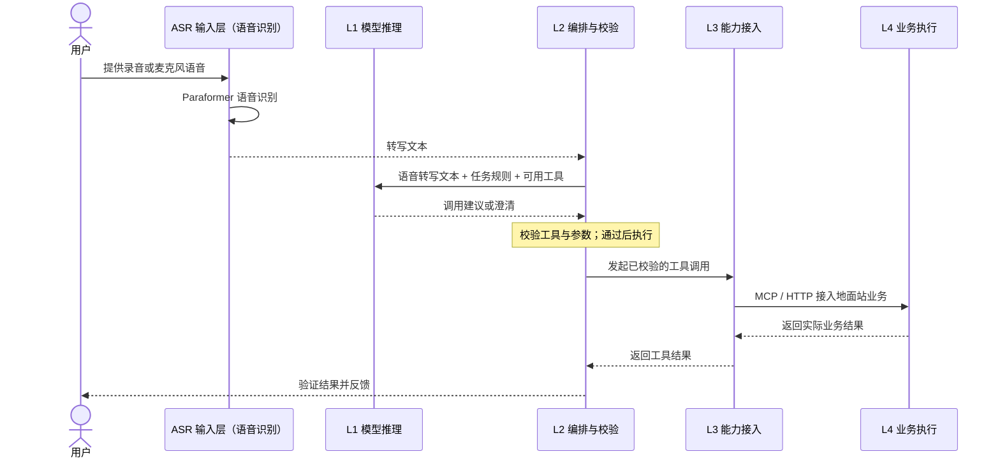
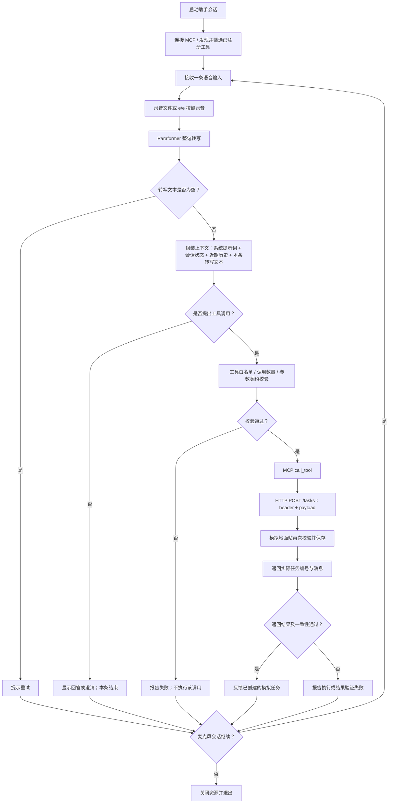
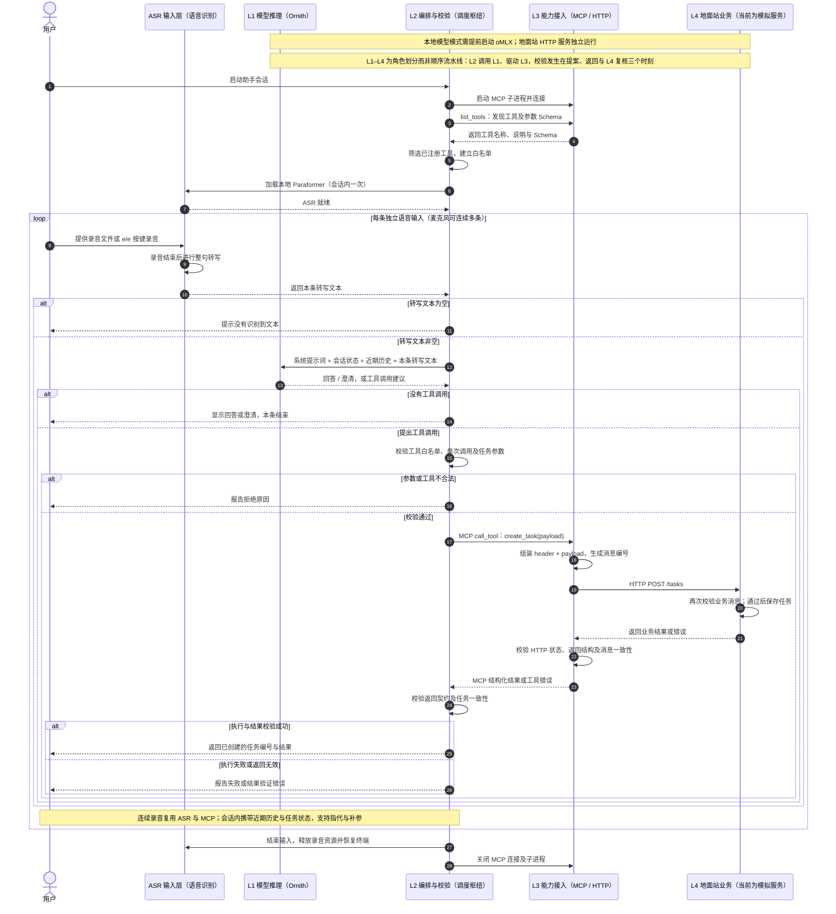
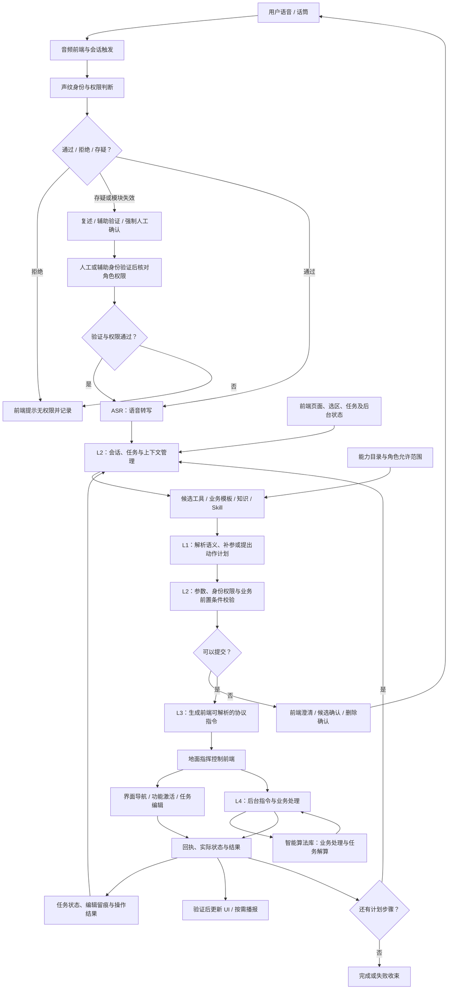
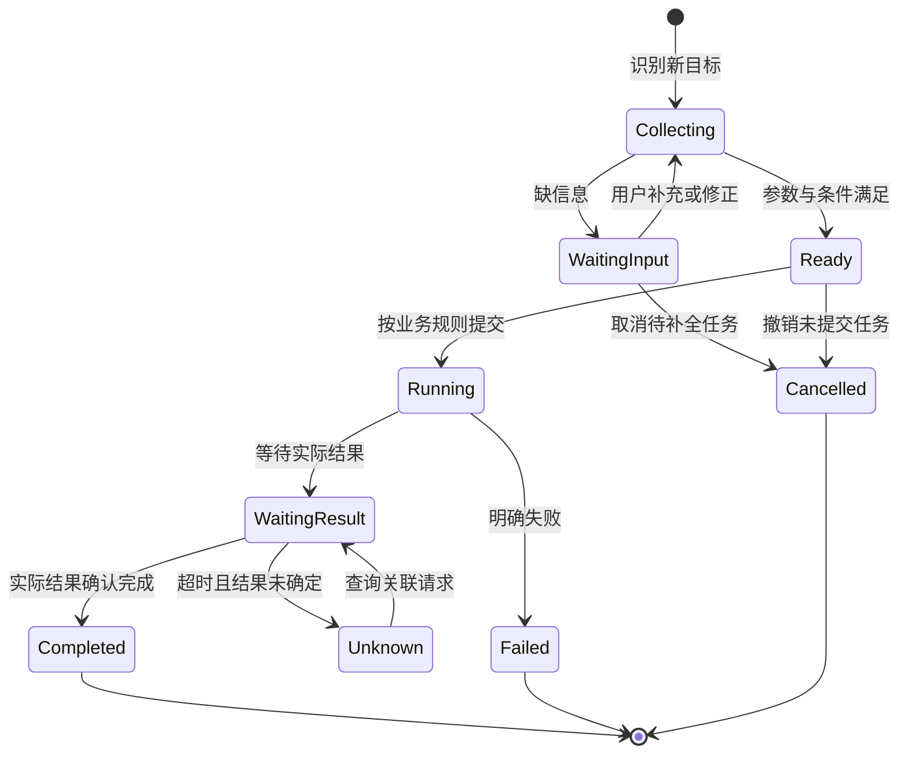

# 工作站助手：总体目标、现状与能力支撑分析

更新日期：2026-10-15（Asia/Shanghai）

本文是思路分析报告，回答三个问题：助手要做成什么（总体目标）、现在做到哪了（现状）、靠什么能力支撑（能力域）。文中不包含建设排期与验收标准；需求来源与历史证据见文末附录。

## 1. 总体目标：两类业务职责

语音助手的目标可以归结为两类：

| 目标 | 定义 | 用户价值 |
| --- | --- | --- |
| 目标一：业务流程把控 | 对某一类型业务（无人机集群任务）的完整流程进行语音操控：界面导航、任务创建、参数编辑、指令下发、执行监控 | “以说代点”，等效替代鼠标键盘操作 |
| 目标二：数据搜集与总结分析 | 围绕业务过程搜集业务数据与工程运行数据，支持查询、跟踪、汇总与总结分析 | 不翻界面、不导表格，用语音直接获得信息与结论 |

两类目标的关系：目标一的每次流程执行都会产生数据——任务记录、指令回执、状态变化、操作留痕——这是目标二的数据来源；目标二提供的查询与结果跟踪能力，又反过来帮助目标一确认每一步操作的实际结果。两类目标共享同一套业务对象与契约（[shared/contracts.py](../shared/contracts.py)），也共享语音入口、语义解析与身份鉴权等基础能力。

### 1.1 目标一：业务流程把控

需求文档将交互目标定义为“语音—意图—指令”闭环：操作人员通过话筒表达意图，语音语义模块生成前端可解析的协议指令，等效替代鼠标操作；需要下发的指令由前端送至后台，后台调用智能算法库处理，结果回传前端呈现。语音模块、前端、后台和算法库均应集成部署于笔记本电脑，形成单机可携、即开即用的终端。

前期明确需求是三条业务线路，推荐验证顺序为“打开界面 → 添加任务 → 下发指令”：

| 线路    | 需求中的典型口令             | 用户应观察到的结果                             |
| ----- | -------------------- | ------------------------------------- |
| 界面导航  | “打开集群任务界面”           | 目标界面激活并置顶；其他界面后台驻留；重复唤起只激活已有实例        |
| 任务添加  | “添加放飞前出任务”           | 自动进入集群任务界面、唤起添加子任务窗口、任务正确入列；参数按类型模板填充 |
| 指令类控制 | “上传预规划”“执行指令”“暂停指令”等 | 指令到达后台，显示真实回执，任务状态及平台响应与实际执行同步        |

最终明确需求包括四项扩展。其中任务编辑闭环与功能全域调用属于目标一本体；声纹身份鉴权与方言环境适应是支撑目标一在真实组织、真实环境中可靠运行的共性能力，其技术内容归入语音域（见 3.3）。

| 最终目标      | 明确要求                                 | 与前期的差异            |
| --------- | ------------------------------------ | ----------------- |
| 任务编辑闭环    | 添加、删除、参数修改；相对量、多参数、连续 / 批量编辑；修改留痕与撤销 | 从单次添加扩展到完整编辑流程    |
| 功能全域调用    | 菜单、按钮、工具栏、视图模式和查询；界面 + 功能 + 对象组合口令   | 从打开界面扩展到界面内功能调用   |
| 声纹身份鉴权    | 指定人员及相应权限的口令才能生效；拒绝、存疑和失效降级均有定义      | 引入说话人身份及操作范围控制    |
| 方言与复杂环境适应 | 方言口音、混合表达、术语热词、作业噪声；低置信结果确认          | 从安静环境普通话扩展到真实作业环境 |

针对“功能全域调用”，应先建立“点说等效”能力对照表：每一项可点击功能对应页面 ID、功能 ID、业务作用、可见 / 可用条件、目标对象、角色权限、语音表达及结果验证方式。该表既是工具目录的来源，也是覆盖率分析与语音回归测试的依据。当前界面不存在或不可用的功能应明确反馈不可用。

#### 任务编辑与默认参数的具体要求

任务模板应由业务系统提供并版本化。需求中的起飞高度、编队构型、适用平台类型是模板字段示例，当前契约未全部覆盖。默认填充规则建议为：明确口令优先；未指定字段可使用已批准的对应类型模板；仍缺少必填值时再澄清。参数记录其来源，不能由模型猜测“默认值”。任务添加不自动等同于上传或执行。

“删除第三个任务”应先将当前列表序号解析为稳定任务 ID，并在确认时复核列表状态；按类型名称指代多个任务时需要澄清。删除完成后按需求重排显示编号，并验证实际移除结果。

“高度增加 100 米”“速度降低 20%”要读取当前值，核对单位与可修改状态，再计算目标值；一句话的多个参数或多个动作应形成有序步骤，逐项验证、执行、回显。出现失败时明确剩余步骤如何处理。参数值、范围、单位换算和编辑权限来自真实业务规则。

操作留痕至少包含操作人、时间、任务 ID、原始口令、修改前后值及实际结果。为“撤销上一步”定义可撤销的编辑动作和逆操作；业务执行或终止不应被当作普通数据修改来撤销。

#### 控制指令与状态迁移

| 口令           | 需求中的预期效果                             | 验证依据             |
| ------------ | ------------------------------------ | ---------------- |
| 上传指令 / 上传预规划 | 后台接收并校验规划数据，任务进入已上传 / 待执行状态，界面展示规划航线 | 后台回执、计划版本和任务状态   |
| 执行指令         | 待执行转为执行中，平台按规划动作，状态灯与进度更新            | 实际执行受理与平台 / 任务反馈 |
| 暂停指令         | 任务进入暂停态，平台按业务定义保持待命，显示暂停确认           | 后台暂停回执及实际状态      |
| 继续指令         | 从暂停态恢复，按需求从断点继续                      | 恢复回执、进度及断点信息     |
| 终止指令         | 退出执行，按业务规则返航或待机，完成状态归档               | 终止回执、平台状态与归档结果   |

源文档对“暂停”的类型栏使用“任务中止”，但预期状态描述为暂停；本规划按预期行为区分暂停与终止，最终名称、状态码和允许迁移以实际后台协议确认。终止后的返航 / 待机方式也不能由 LLM 自行选择。

应定义每个指令的合法前置状态、作用任务 / 平台、允许权限、请求关联号及回执时限。非法状态迁移由程序 / 后台拦截；超时先核查请求状态，不能因重发造成重复操作。声纹会话续接、助手待办续接和后台“继续执行”是不同状态，不应共用一个模糊的“继续”标记。

### 1.2 目标二：数据搜集与总结分析

目标二让助手不止于“替用户操作”，还能“替用户看数据”。搜集的数据分两类：

| 数据类别 | 内容 | 支撑的使用方式 |
| --- | --- | --- |
| 业务数据 | 任务记录、执行回执、状态变化、操作留痕 | 状态问答、任务结果跟踪、汇总统计、复盘报告 |
| 工程运行数据 | 日志关联、转写与意图准确率、各环节延迟、资源占用 | 运行质量评估、故障定位与效果迭代 |

典型使用场景：

| 场景 | 口令示例 | 预期效果 |
| --- | --- | --- |
| 状态问答 | “现在有哪些任务”“三号机什么状态” | 基于业务系统当前状态回答，而不是复述历史对话 |
| 结果跟踪 | “预规划上传成功了吗” | 按请求关联号查询回执、任务状态与平台实际响应 |
| 汇总统计 | “统计本次行动的任务执行情况” | 汇总任务记录与执行结果，形成结构化结论 |
| 复盘报告 | “生成今天的任务执行报告” | 汇集操作留痕、修改前后值与实际结果，输出可核查的报告 |

来源定位说明：源文档将状态问答、地图上下文、多轮澄清、任务结果跟踪和订阅事件列为明确目标之上“可补充”的助手能力。本规划将状态问答、任务结果跟踪、订阅事件与工程运行数据分析一起提升为目标二，与流程把控并列；地图上下文与多轮澄清不单列为目标，分别归入工作站上下文（认知域）与对话管理（编排与执行域）。

建设原则：业务数据必须来自业务系统与程序记录，不能由模型生成或猜测；历史结果按任务 / 操作编号查找，并区分历史事实与需要再次查询的实时状态。指标分析应分别统计 ASR 错误与语义处理错误，不能用固定模拟口令代替真实模型准确率，也不能只用推理速度（tok/s）判断工作体验。

### 1.3 目标与源需求对照

下表编号用于本项目跟踪，源文档依据以章节名称标识；“归属”列标注该需求服务于哪类目标。

| 编号    | 明确需求及源章节             | 归属 | 当前覆盖                    | 尚需完成                                |
| ----- | -------------------- | --- | ----------------------- | ----------------------------------- |
| S5-01 | 系统架构：单笔记本集成、可携、即开即用  | 共性 | ASR 与 LLM 本地运行，业务仍为模拟服务 | 集成真实前端、后台及算法库；统一部署、启动、健康状态和模型资源管理   |
| S5-02 | 前期目标三：打开指定界面         | 目标一 | 未实现                     | 页面对象目录、路由、激活置顶、复用已开实例、保留上下文与返回路径    |
| S5-03 | 前期目标一：添加任务及界面操作序列    | 目标一 | 模拟新增任务，可解析五种参数变体        | 真实任务界面与添加窗口、数据入列和 UI 结果验证           |
| S5-04 | 前期目标一扩展：默认参数、连续添加    | 目标一 | 按键连续输入，但每条独立；没有默认参数模板   | 版本化类型模板、一次唤醒会话、按语音顺序入列、不重复触发        |
| S5-05 | 前期目标二：上传、执行、暂停、继续、终止 | 目标一 | 未实现                     | 指令协议、作用对象、后台状态机、算法调用、回执及实际平台状态同步    |
| S5-06 | 最终目标一：删除与参数调整        | 目标一 | 未实现                     | 稳定对象定位、删除确认、参数名 / 值 / 单位、相对计算与多参数修改 |
| S5-07 | 最终目标一扩展：批量、留痕、撤销     | 目标一 | 仅接受每条口令一次调用             | 有序动作计划、逐步回显、操作者 / 时间 / 前后值记录及可撤销编辑（留痕同时服务目标二） |
| S5-08 | 最终目标二：全域功能调用         | 目标一 | 未实现                     | “点说等效”功能对照表、复合口令、当前界面功能可用性判断        |
| S5-09 | 最终目标三：声纹及角色权限        | 共性 | 未实现                     | 声纹库生命周期、角色映射、通过 / 拒绝 / 存疑、持续鉴权与失效降级 |
| S5-10 | 最终目标四：方言与环境适应        | 共性 | 本地 Paraformer 与有限样例验证   | 地域语音评测、热词导入、混合表达、噪声测试及低置信确认         |
| N-01 | 规划新增：状态问答与结果跟踪 | 目标二 | 模拟任务仅落盘 JSON 文件 | 业务查询接口、请求关联号机制、实时状态与历史事实区分 |
| N-02 | 规划新增：汇总统计与复盘报告 | 目标二 | 无 | 操作留痕数据完备、汇总模板、结果可核查 |
| N-03 | 规划新增：工程运行数据分析 | 目标二 | 基础日志、25 项回归测试、有限测速 | 统一编号关联、指标采集、真实场景评测集 |

### 1.4 共同体验要求

以下要求同时适用于两类目标。

用户应能看到助手正在听取、识别、理解、补参、执行还是等待结果；能明确知道操作涉及哪个业务对象、缺少什么信息、实际完成了什么，以及失败后可以怎样继续。任务执行过程不应因一句模糊的“这个”“继续”而关联到错误对象。

用户通过语音表达需求、补充参数和修正意图。工作站的按钮、地图选区和选中对象作为业务上下文，UI 用于展示澄清、进度及结果。先打通基础语音业务闭环，再按使用环境增加免手、远场和多人交互能力；是否播报由使用场景决定。

“任务记录已创建”“请求已被业务系统接受”“业务执行完成”应有不同的反馈语义。后台长任务需要进度、结果查询和失败恢复，不能统一按即时工具返回处理。

需求中的“无需鼠标与键盘介入”应覆盖导航、参数录入和语音流程内的确认。删除需要弹出确认并在确认后执行；应建设可由语音完成的确认过程。声纹存疑的辅助验证或失效降级通道，需要另行明确其交互方式，不能默认已有该能力。

界面呈现本身也是结果的一部分：不仅要求后台数据改变，还要验证窗口激活、弹窗收束、任务列表顺序、参数显示、状态灯 / 进度以及修改留痕。

## 2. 现状：现有框架与运行流程

### 2.1 现有框架与分层职责

目前 demo 统一以语音作为用户需求入口：用户通过麦克风或录音提供口令，本地语音识别模型 Paraformer 将语音转成文字，本地大语言模型（Qwen 3.8 35B A3B）提出一次工具调用，经编排层校验后，通过 MCP 与 HTTP 发送到模拟地面站，保存任务并返回结果。

下面用一张上层时序图概括职责与主链路。ASR 输入层负责录音与语音转写；L1 提出建议，L2 组织执行，L3 接入能力，L4 处理业务并返回实际结果。ASR 单独列在 L1–L4 之外，所有用户口令经语音识别后进入 L2。



1. **ASR / 输入层**：负责按键控制录音，通过开源 ASR（Automatic Speech Recognition）框架 FunASR 的开源语音识别模型 Paraformer Large 将语音转成文字。
   FunASR 是阿里巴巴达摩院开源的一套工业级端到端语音识别工具包（GitHub: modelscope/FunASR），把语音识别、语音活动检测（VAD，Voice Activity Detection）、标点恢复、说话人分离、情感识别等能力打包成开箱即用的流水线，代表模型是中文精度领先的非自回归模型 Paraformer 和支持中/粤/英/日/韩五语种 + 情感与音频事件检测的 SenseVoice。
2. **L1 模型推理**：根据固定提示词、工具 Schema 和本条语音口令的转写文本，提出工具调用或澄清。**当前项目本地推理使用 oMLX（面向 Apple Silicon 的 MLX 推理框架），加载 Qwen 3.8 35B A3B 的 6bit MLX 微调权重运行。后续迁移到 Windows 时，计划改用 LM Studio、llama.cpp 等支持 GGUF 的推理框架，并将模型切换到 Qwen 3.8 27B。**

   L1 提出的工具调用 JSON 结构样例（以“C 型编队”为例）：

   ```json
   {
     "payload": {
       "action": "create_task",
       "task": {
         "task_type": "编队飞行任务",
         "parameters": {
           "formation_type": "C型"
         }
       }
     }
   }
   ```

3. **L2 编排与校验**：发现工具后筛选已注册能力，校验调用参数与返回结果，并反馈执行情况。校验发生在三个时刻：执行前校验模型提案（工具白名单与参数契约）、执行后校验返回结果（返回契约与业务一致性），L4 侧再用共享契约复核业务消息；L2 与 L4 校验同一份契约（[shared/contracts.py](../shared/contracts.py)）。L2 是调度枢纽——由它调用 L1、驱动 L3，四层是角色划分而非顺序流水线。

   <br />
4. **L3 能力接入**：通过 MCP 客户端与服务端接入工具，提供工具 Schema，并将调用适配为地面站 HTTP 请求。

   现有业务只有一个 MCP 工具 `create_task`，覆盖五种参数变体：原地起飞、指定位置展开、指定区域展开、C 型编队和 U 型编队。
5. **L4 业务执行**：接收完整业务消息，再次校验参数，创建并保存模拟任务，返回实际业务结果。主要代码位于 [simulator/](../simulator/)。
6. **共享与入口**：提供配置、任务契约和终端输出，以及统一启动与 Demo 入口。主要代码位于 [shared/](../shared/) 和 [main.py](../main.py)。

现有代码保留文本入口用于开发调试与语义测试，本文不将其作为用户需求入口。

### 2.2 运行时流程

#### 流程图：处理步骤与分支

下图展示现有语音链路中的识别、模型提案、校验、执行及会话循环。



网络和工具异常同样进入失败处理。成功反馈只依据已验证的业务结果。图中“继续”表示接收新的独立口令，尚不包含语义上的任务续接。

#### 时序图：L1–L4 角色交互

下图按角色展示**现有实现**的调用顺序。L1 提出调用建议，L2 校验并组织执行，L3 通过 MCP / HTTP 接入能力，L4 完成实际业务处理。ASR 是输入角色，单独列在四层之外。



图中省略了传输协议内部细节。模型请求、网络和工具异常进入失败处理；麦克风模式可以显示处理错误后接收下一条口令，录音文件模式出错则退出。录音设备、模型加载等输入端错误的恢复机制仍需完善。

### 2.3 现状在两类目标下的位置

对照目标一：完成的是“语音到模拟业务”的最小链路——一条口令、一次 `create_task` 调用（五种参数变体），执行目标仍是模拟任务存储。尚未驱动真实前端“打开任务界面—打开添加窗口—任务入列”，也没有界面导航、上传 / 执行等控制指令、后台算法库接入。因此，目前完成的是语音到模拟业务的基础链路，不能据此认定“以说代点”的前期目标已经达成。

同时，会话内每轮组装上下文：固定系统提示词、完整工具 Schema、会话任务状态快照（最近任务编号、待补全澄清）、最近 4 轮对话历史和本条转写文字。跨会话不持久化，重启后上下文清空；尚无工作站页面 / 选区等业务上下文接入。麦克风采用单声道按键录音，尚无自动唤醒、声源方向判断和声纹能力。

对照目标二：模拟任务以 JSON 文件落盘（`output/TASK-<id>.json`），仅此而已。没有任务查询、结果跟踪、汇总统计能力；基础日志、25 项回归测试和有限的本机测速构成了工程运行数据的雏形，但尚未形成统一编号关联与指标分析。

模块接口和工具注册表为后续扩展提供了基础。最近记录的 25 项回归测试通过；有限真实模型样例与缓存测速见附录证据链接。这些结果表明单条任务链路可用，整体工作站助手能力仍需建设。本文件是分析文档：未实现的项目不因纳入需求讨论而成为现有能力。

## 3. 支撑能力：按域归位

第 1 节回答“做成什么”，本节回答“靠什么支撑”。能力按六个技术域组织：ASR 与 LLM 提供感知和理解，业务系统与程序状态提供执行依据。工具变多并不自动意味着助手变强，关键在于能否覆盖一个完整工作流程——因此每项具体技术（声纹、流式 ASR、上下文控制、准确度评测等）都应能在下表矩阵中指认它服务的目标；指认不到目标的能力不进入建设范围。

### 3.1 能力域与目标的映射

| 能力域 | 解决的核心问题 | 主要服务目标 | 当前覆盖 |
| --- | --- | --- | --- |
| 语音域 | 听得到、听得准、分得清人 | 目标一的可靠交互入口；声纹同时是权限前提与目标二的数据归属依据 | 终端文字与按键录音；Paraformer 整句转写 |
| 认知域 | 听懂意图、控住输出质量（上下文控制、任务准确度） | 目标一的语义解析与动作计划；目标二的问答理解 | 系统提示词 + 会话状态快照 + 近期历史；单句解析与澄清回复 |
| 编排与执行域 | 提案校验、调度执行、任务状态与续接 | 目标一 | 单次调用与严格校验 |
| 业务接入域 | 连接真实前端、后台与算法库，组织能力目录 | 目标一（操作下发）；目标二（查询接口） | 一个已注册 MCP 工具 + 模拟地面站 HTTP |
| 数据域 | 业务与运行数据的采集、存储、查询与汇总 | 目标二 | 模拟任务 JSON 落盘 |
| 运行与评测域 | 运行质量度量与故障定位 | 目标二（工程侧）；同时是所有域的质量反馈 | 基础日志、25 项回归测试、有限测速 |

### 3.2 目标运行架构

以下是**目标规划**，尚未实现的声纹、前端接口和后台业务明确列在图中。现状架构图见第 2 节。



所有模块部署于同一笔记本，但语音模块、模型服务和工作站各进程可按工程需要分开运行。统一会话 / 任务 / 操作编号，关联前端操作、后台请求、算法结果及平台反馈。导航和部分编辑是否需要后台参与，以真实业务接口为准。

声纹模块失效的降级路径应由程序明确切换为需求规定的“仅语音识别 + 强制人工确认”，确认完成前不自动提交业务指令；该模式的身份验证方式与允许操作范围需确认。图中的辅助验证是流程入口，不表示失效模块自身可以恢复身份判断。

### 3.3 语音域

语音域解决“听得到、听得准、分得清人”。除转写外，声纹鉴权是目标一执行权限的前提，也是目标二操作留痕中“操作人”字段的来源。

#### 先区分三件事

| 概念   | 要解决的问题                 | 所属层                  |
| ---- | ---------------------- | -------------------- |
| 连续收音 | 不用每次按键，自动检测说话开始和结束     | 音频前端、VAD、端点判断        |
| 连续对话 | 下一句能补充、修正和引用上一句        | 会话与上下文管理，接收 ASR 转写结果 |
| 任务续接 | 打断、等待、退出或重启后，接着处理已记录任务 | 任务状态机与业务结果查询         |

升级 ASR 并不会自然获得后两种能力。现有 Paraformer 是整句转写；是否更换流式模型，应看首字反馈、长口令和持续交互的实际需求。

#### 语音能力选择表

| 能力                 | 解决的问题                      | 建设前提与评测重点                             | 建议引入条件                          |
| ------------------ | -------------------------- | ------------------------------------- | ------------------------------- |
| 自动语音活动检测与端点判断（VAD） | 自动开始 / 结束一段话，减少按键          | 短暂停顿、长坐标口令、静音和背景人声；截断率与结束等待时间         | 确定采用持续收音后优先建设                   |
| 流式 ASR             | 边说边显示文字，降低感知等待             | 部分结果会修订；确定最终结果和可提交时机；数字、坐标、术语识别       | 整句识别影响体验或口令较长时                  |
| 语音唤醒与会话窗口          | 支持一次唤醒内连续添加 / 编辑，区分空闲与活跃会话 | 唤醒词、窗口保持、退出与超时；误唤醒 / 漏唤醒及连续指令顺序       | 需求扩展明确提出一次唤醒连续操作，基础闭环后建设        |
| 降噪与去混响             | 在设备噪声、远场和室内反射中保留有效语音       | 用真实环境录音验证；重点看数字 / 坐标错误，避免处理后反而失真      | 环境测试表明噪声显著影响任务时                 |
| 回声消除（AEC）          | 助手播报不被重新识别为用户输入            | 播放参考信号、音频时序和播放设备接入                    | 引入扬声器播报与持续收音后                   |
| 声源方向 / 角度限制        | 只接收操作位或指定扇区的声音             | 声源定位或设备提供的方向元数据、麦克风安装与方向校准；多人、转头和移动场景 | 明确操作位和声学硬件条件后                   |
| 声纹身份鉴权与说话人区分       | 只有匹配身份且具有对应权限的口令可生效        | 声纹库、角色权限、通过 / 拒绝 / 存疑、持续鉴权及失效降级       | 最终阶段明确需求，须从早期预留身份与角色接口          |
| 播报（TTS）            | 用户不看屏幕也能得到澄清与结果            | 播报长度、重要事件排序、视觉反馈一致性                   | 用户经常无法关注屏幕时                     |
| 语音打断               | 用户可以打断播报、修正请求或停止后续步骤       | 区分停止播报、停止生成、撤销未执行步骤和申请取消业务任务          | 有长播报、长生成或多步任务时                  |
| 专业术语与数字纠错          | 正确理解任务名、参数、设备编号和坐标         | 业务词表配置、热词一键导入、关键实体校验和候选确认             | 源需求明确要求术语热词，从首轮录音评测开始建设         |
| 方言 / 口音与混合表达       | 不同地域操作者在噪声环境下使用自然口令        | 地域优先级、口音 / 方言样本、普通话混说与语种切换；逐批评测       | 最终阶段明确需求；当前 Paraformer 的覆盖范围需实测 |

VAD 的作用是判定音频帧是否有语音；唤醒、身份和方向判断需要其他模块。[WebRTC VAD 接口说明](https://github.com/wiseman/py-webrtcvad) 降噪和 AEC 也应独立评估其作用与输入条件。[Speex 音频处理说明](https://speex.org/docs/manual/speex-manual/node7.html)

#### 声纹身份与角色权限

源需求要求在语音语义识别前完成声纹比对；通过后，具体操作仍需按角色权限判断。权限等级是源文档的建议分级，落实前需确认实际组织角色与具体指令范围。

| 建议角色  | 源需求中的可执行范围                |
| ----- | ------------------------- |
| 指挥员   | 全部功能，包括任务编辑、指令下发与界面调用     |
| 操作员   | 任务编辑和界面调用；指令下发受限，具体允许项待确认 |
| 观察员   | 仅界面浏览，禁止写入与指令下发           |
| 未注册人员 | 拒绝全部语音控制                  |

声纹样本采集注册、更新和注销需有管理员确认与留痕；长时会话应周期性复检，人员交接重新鉴权。拒绝时提示无权限并记录；存疑时要求复述或辅助验证。模块失效时按源需求进入强制人工确认模式，不能自动放行。身份结果应绑定会话并在执行边界再次核对。

#### 方言、复杂环境与低置信度确认

按使用地域确定优先覆盖人群，分批构建标准普通话、口音、方言与作业噪声测试集，覆盖混说及中途语种切换。提供业务热词配置与导入入口，统一任务、参数和平台名称。

低置信或关键实体存疑时，前端展示候选，如“是否添加放飞前出任务”，由操作者确认后再继续。语音流程中的确认应能用语音完成，并绑定明确对象及有效期。阈值由评测确定；不能把 LLM 自述置信度当成可靠的声学评分。现有 ASR 接口只返回转写字符串，后续需补充可用的质量信息或其他可疑结果检测方式。

#### 声源角度限制的专门说明

“对话角度限制”已确认是**声源方向 / 角度限制**。建议先明确：麦克风安装位置、操作员通常所在区域、是否允许转头 / 离席发言、侧面协作者能否加入，以及方向门限在哪些会话阶段生效。

当前录音仅获取单声道音频，没有方向元数据。要实现这一能力，需要可访问的阵列多通道数据，或能直接提供声源方向（DOA）的设备；软件再将方向、语音活动及会话状态结合判断。只对转写文字加规则无法恢复声源方位。已有阵列产品提供 DOA、波束成形、VAD、AEC 等接口，说明这些属于硬件与音频前端的能力；具体选型和 Mac 接入仍需实测。[麦克风阵列能力示例](https://wiki.seeedstudio.com/ReSpeaker_Mic_Array_v2.0/)

扇区宽度不能预先当作已验证参数。应通过正前方、侧方、背向、转头、远近变化和多人说话的录音测试，选取可接受的误接收与误拒绝表现。唤醒后是否继续严格限制方向，也应按操作者移动习惯决定。

### 3.4 认知域

认知域解决“听懂什么、怎么控制模型输出质量”，两条主线是**上下文控制**与**任务准确度把控**。

#### 上下文管理是基础能力

建议每轮按任务需要构造上下文，而非把全部历史无限追加：

```text
固定职责与规则
+ 当前用户与工作站上下文
+ 当前任务的结构化状态、待补全参数及指代对象
+ 必要的近期对话 / 历史摘要
+ 新鲜的业务查询结果和相关知识
+ 候选工具完整 Schema / 选定 Skill 的步骤说明
+ 本轮输入
```

| 上下文类型     | 保存与使用原则                                       |
| --------- | --------------------------------------------- |
| 固定规则      | 版本化、明确业务范围和结果反馈规则；保持稳定以利于缓存                   |
| 当前会话      | 保存一次唤醒的窗口、身份 / 角色、近期必要轮次、澄清问题及人员交接            |
| 当前任务      | 用结构化数据保存目标、对象、参数、阶段与依赖；模型可提出修改，程序负责校验与提交      |
| 工作站状态     | 保存当前页面、可用功能、任务列表顺序与稳定 ID、当前参数值 / 单位、平台状态及对象版本 |
| 业务模板与编辑记录 | 模板版本、默认参数来源、修改前后值、操作者与操作序列，支撑相对调整和撤销          |
| 历史结果      | 按任务 / 操作编号查找；区分历史事实与需要再次查询的实时状态               |
| 长期记忆      | 按需求保存可核实的用户偏好或常用配置；明确作用范围和用户修改方式              |
| 手册与工具返回   | 作为有来源的数据或知识使用，不能自动变成助手执行规则                    |

对话摘要服务于理解，实际任务状态保存在程序和业务系统中。前缀缓存服务于性能，不承担对话记忆或持久化任务状态。

#### 本地模型的建设方向

先定义模型应输出哪些可校验的结果：意图类别、界面 / 功能 / 任务对象、稳定对象标识或待澄清指代、参数名 / 值 / 单位、绝对或相对调整、缺失字段、澄清需求及有序动作计划。针对源需求区分添加、删除、参数修改、上传、执行、暂停、继续、终止和导航，重点验证相邻控制指令的混淆。是否采用统一结构化决策协议，应与编排层的消费方式一起设计。

评测重点包括任务理解、指代与纠正、否定判断、工具选择、关键实体提取，以及对不完整信息的处理。模型自述“有把握”不能作为唯一执行依据；可疑结果应结合程序校验、实际状态和交互核对处理。

模型大小、量化、思考模式、输出长度和提示词优化是实现选择，需要用正确率与端到端等待时间比较。保持模型接口可替换；不要将整个任务状态和工作流程都编码在某个模型的固定提示词里。

#### Skills 在能力建设中的位置

可以将 Skill 设计为**一个可复用工作方法**，包含适用条件、必要输入、业务知识、允许使用的工具、步骤及验收方式。Agent Skills 的公开形式将说明、资源和可选脚本组合为可发现的能力包，可作为组织方式参考；是否采用该格式由本项目决定。[Agent Skills 概述](https://agentskills.io/home)

| 组件        | 在建议架构中的职责               |
| --------- | ----------------------- |
| MCP 工具    | 提供一次明确的业务查询或操作          |
| Skill     | 说明如何组合知识与工具完成某类工作       |
| LLM       | 结合用户目标与上下文，选择方法并提出参数或计划 |
| 编排器与任务状态机 | 校验、调度、记录实际结果，并控制续接和失败处理 |

可优先考虑的 Skill 示例是“打开集群任务界面—打开添加窗口—按模板添加任务”“预规划校验—上传—等待回执”和“定位任务—确认参数变更—写入并留痕”。这些示例依赖相应业务查询和操作接口，目前尚未实现。

建议先通过一个重复出现的真实工作流程验证 Skill：规定触发条件、输入 / 输出、步骤依赖、业务规则、失败处理和版本；随后实现按需加载，避免每轮把所有 Skill 塞入上下文。确定性步骤可由程序或声明式工作流执行，需要语义判断的步骤再交给 LLM。当前单一 `create_task` 链路没有必要为了形式先引入完整 Skill 框架。

#### 知识检索与工具召回

知识检索用于找到手册、规则和历史证据；工具召回用于缩小能力候选，两者应建立各自的目录和评测集。EmbeddingGemma 2 可作为候选嵌入模型，但尚未接入，部署兼容性与本机耗时仍待验证。

工具少时，直接提供完整工具列表更容易控制。工具数量和描述开销增长后，再评估“已注册与可用能力过滤 → 语义候选 → 完整 Schema → LLM”。候选缺失时需要明确扩大候选、再次查询或澄清的策略。工具子集和 Skill 的变化会影响缓存前缀，需比较召回准确率、实际 token 数、首 token 等待和总耗时。

### 3.5 编排与执行域

编排与执行域解决“提案是否可信、执行是否可控、任务是否可续”。L2 是调度枢纽，校验发生在三个时刻：执行前校验模型提案（工具白名单与参数契约）、执行后校验返回结果（返回契约与业务一致性）、L4 侧用共享契约复核业务消息；L2 与 L4 校验同一份契约（[shared/contracts.py](../shared/contracts.py)）。

#### 多轮澄清与任务续接

建议为任务保存唯一编号、目标、对象、参数及来源、待补全字段、执行阶段、已完成步骤、回执、取消 / 暂停状态，以及所属会话和操作者。



该状态图为最小建议；需进一步定义排队、暂停、恢复、多个任务并存和业务取消的规则。“停止播报”不应隐式删除任务；已提交业务请求的取消需要业务接口支持，并验证实际结果。

任务续接分三层实现：同一会话下一句补参；当前操作打断后继续；进程重启后恢复任务。先实现第一层，再建设持久化、状态查询及重复请求控制。恢复时核对对象和参数是否仍有效，不能只凭历史文本再次执行创建。

源需求的一次唤醒连续编排、单句多个编辑动作，要求会话管理与有序执行同时建设。当前每条输入最多一次工具调用的约束需扩展为“一个目标生成经校验的有序步骤、每步执行后核查结果”，而不是直接无条件执行模型返回的多个调用。助手任务状态与后台业务任务状态分别记录；语音“继续指令”恢复的是指定业务任务，不自动等同于继续助手计划。

### 3.6 业务接入域

业务接入域解决“助手如何连接真实前端、后台与算法库，并把能力组织成目录”。

#### 能力目录的建设原则

优先从实际业务接口提供原子能力，例如读取任务、获取当前选区、准备任务参数、创建任务、查询进度。为每个能力定义输入、输出、对象范围和失败语义，明确哪些操作只是读取、哪些会改变业务状态，以及哪些阶段需要操作者确认。

MCP 负责工具发现与调用接口；能力是否适用于当前用户、对象和业务状态，由工作站程序与编排层判断。MCP 工具支持描述、输入 / 输出 Schema 和目录变更通知，可以用于构建能力目录；具体业务组织方式属于本项目设计。[MCP 工具规范](https://modelcontextprotocol.io/specification/2025-11-25/server/tools)

接口优先使用工作站已有 API 或结构化事件。只有在缺少接口时才评估 UI 自动化，并明确其状态读取与执行结果验证方式。

导航与编辑优先调用前端已有业务接口，保留界面路由和交互状态；需要下发、任务解算的指令走前端—后台—算法库链路。具体任务数据由前端还是后台持有、何时保存与上传，需要对照现有工作站确认，不能把所有操作都映射成同一个后台 HTTP 请求。

#### 需求架构与 L1–L4 的对应

需求文档按“话筒—语音语义模块—地面指挥控制前端—后台—智能算法库”划分系统；本项目 L1–L4 按助手职责划分，两者不是一一对应的部署进程。

| 需求中的系统模块    | 在本项目建议架构中的位置                                |
| ----------- | ------------------------------------------- |
| 话筒与语音语义识别模块 | 音频前端 / 声纹鉴权 / ASR + L1 语义解析；L2 管理会话、规则和任务状态 |
| 地面指挥控制前端    | L3 的协议与业务接口适配连接真实前端；前端负责导航、窗口、任务编辑与结果呈现     |
| 地面指挥控制后台    | L4 的真实业务服务，处理下发指令、状态迁移和任务结果                 |
| 智能算法库       | 后台按业务需要调用的意图处理与任务解算能力；本地 LLM 不替代其业务职责       |

前端界面是助手操作的业务对象，也是结果展示入口。语音命令经协议驱动业务接口，并不要求机械模拟所有鼠标动作。助手侧 L1 / L2 与后台算法侧的意图处理、参数校验和任务解算边界仍需对接确认。

### 3.7 数据域

数据域是目标二的专属支撑，解决“数据从哪来、存在哪、怎么查、怎么汇总”。

**数据对象与来源**：业务数据（任务记录、指令回执、状态变化、操作留痕）来自 L4 / 真实后台与程序记录；工程运行数据（日志、指标）来自运行与评测域。操作留痕字段沿用 1.1 已定义的最小集：操作人、时间、任务 ID、原始口令、修改前后值及实际结果。

**建设要点**：读接口先行——读取任务、获取当前状态、按请求关联号查回执，是状态问答与结果跟踪的最小依赖；历史结果按任务 / 操作编号查找，区分历史事实与需要再次查询的实时状态；汇总统计基于留痕与回执生成，结论必须可回溯核查，不能由模型臆造。

**起步路径**：状态问答（依赖读接口）→ 结果跟踪（依赖请求关联号）→ 汇总统计（依赖留痕与回执数据完备）→ 复盘报告。当前模拟服务已将任务按 `output/TASK-<id>.json` 落盘，可作为查询接口的最小原型数据源。

### 3.8 运行与评测域

运行与评测域支撑目标二的工程侧，同时为所有能力域提供质量反馈：日志关联、准确率、延迟、资源、部署、版本与故障定位。

分析原则：测试应覆盖真实音频、不同背景条件和完整业务链路，分别统计 ASR 与语义处理错误；不能用固定模拟口令代替真实模型准确率，也不能只用推理速度判断工作体验。统一会话 / 任务 / 操作编号是日志关联和结果跟踪的共同前提，应尽早进入架构。

当前覆盖：基础日志、25 项回归测试、有限的本机测速（见附录）。尚需：真实场景评测集、统一编号关联和可复现的部署基线。

## 附：需求来源、现有实现与历史证据

- [专题5增加语音和语义识别](专题5增加语音和语义识别.docx)：三条前期线路、最终四项目标、架构、示例及完成判据的来源。
- [项目使用说明](../README.md)：现有安装和启动命令。
- [架构与扩展说明](architecture.md)：当前接口、模块和扩展入口。
- [缓存性能报告](cache-performance.md)：已完成的本机测速及 512-token 启动适配，适用于已验证的 oMLX 0.6.3rc2。
- [历史状态快照](archive/project-status-20261014-snapshot.md)：原文中的测试、启动和瞬时运行状态。运行快照不表示当前服务状态。
- [回归测试](../tests/)：最近记录为 25 项通过；本次只调整文档，没有重新运行程序测试。

后续迭代应同时更新“用户能完成的工作”“能力依赖”“当前实现状态”和证据链接，使组件选择始终服务于工作流程。
