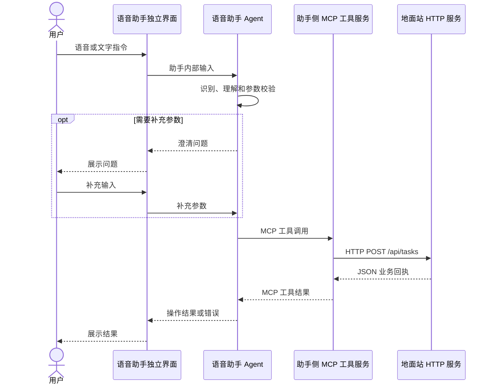

# 地面站对接接口文档

版本：2.0.0（解耦方案草案）；修订日期：2026-10-26。

语音助手具有独立界面，自行控制麦克风、语音识别、对话和结果展示。地面站提供 HTTP 服务端，接受语音助手侧 MCP 工具发出的业务请求，并返回处理结果。本文约定双方的业务 HTTP 边界。

本文是新的对接方案。仓库已新增独立的 Python 地面站 HTTP 模拟服务 `simulator/http_server.py`，可用于验证本版三个接口；当前助手 MCP 工具仍调用本地 `TaskStore`，尚未通过 HTTP 模拟服务或适配真实地面站。现有 `地面站对接接口-v1.0.0.openapi.yaml`、`swagger-ui.html` 及旧版 Word、压缩包仍描述旧方案，不能作为本版联调依据。

## 1. 职责与调用方向

| 参与方 | 负责内容 |
| --- | --- |
| 语音助手独立界面 | 开始/停止录音、文字输入、识别文本、对话、补充参数、操作结果和错误展示 |
| 语音助手 Agent | ASR、意图理解、参数校验、上下文管理、工具选择与调用 |
| 助手侧 MCP 工具服务 | 封装地面站业务能力，将工具调用转换为 HTTP 请求，解析回执并返回 Agent |
| Qt 地面站 HTTP 服务 | 校验业务请求、创建/上传/执行任务、维护真实任务状态、返回业务结果及错误 |



MCP 客户端和 MCP 工具服务均属于语音助手侧。地面站接收普通 HTTP JSON 请求，无需实现 MCP 协议、工具发现或模型接入，也无需调用语音助手、提供录音按钮或接收识别文本、澄清和助手后台错误事件。

地面站的任务数据和操作状态以地面站为准，助手根据地面站回执更新本地展示。

## 2. 服务地址与接口范围

地面站服务地址拟由助手配置为 `GCS_BASE_URL`，实际协议、主机与端口在部署时确定。调用地址为 `<GCS_BASE_URL>/api/tasks`。Agent 自身的 `127.0.0.1:18002` 是助手内部服务地址，不作为地面站服务地址。

沿用原任务接口的路径和操作名称，最小对接范围如下：

| 编号 | HTTP 方法与路径 | 请求 payload.type | 功能 |
| --- | --- | --- | --- |
| G1 | POST /api/tasks | create_task | 创建任务草稿，返回地面站分配的任务编号 |
| G2 | POST /api/tasks | upload_task | 上传指定任务，返回上传结果 |
| G3 | POST /api/tasks | execute_task | 启动指定任务，返回启动结果 |

三项操作分别发起，创建成功不自动上传或执行。任务查询、任务列表和长时间操作的进度查询若联调需要，可另行补充；本版不假定地面站已经提供这些能力。

## 3. HTTP 消息约定

### 3.1 统一信封

请求与响应均为 UTF-8 编码的 `application/json`，采用 `header + payload`。`header` 是 JSON 内的业务消息头，与 HTTP 请求头不同。MCP 外层仍遵循标准 MCP 协议，本文信封仅约定工具到地面站的 HTTP 消息。

| header 字段 | 规则 |
| --- | --- |
| msg_id | 必填，`MSG-` 加标准小写 UUID；每条新消息生成 UUID v4；同一请求重试保留原编号 |
| msg_type | 请求固定 `TASK_COMMAND`；成功和错误响应均固定 `TASK_RESULT` |
| version | 本版地面站 HTTP 协议固定 `2.0.0` |
| src | 请求为助手 `{type: "BACKGROUND", id: "AGENT-01"}`；响应为地面站 |
| dst | 请求为地面站 `{type: "FRONT", id: "GS-01"}`；响应为原请求的 src |

`FRONT` / `BACKGROUND` 沿用旧协议的端点标识，不表示地面站承载助手界面。不同实例可配置各自的 id。`msg_id` 格式为 `^MSG-[0-9a-f]{8}-[0-9a-f]{4}-[0-9a-f]{4}-[0-9a-f]{4}-[0-9a-f]{12}$`。

每条响应生成自己的 `msg_id`，请求与响应通过当前 HTTP 调用对应。地面站接口不携带 `record_id`，也不依赖录音轮次；一次录音、文字输入或多轮澄清与业务请求的关联由助手内部维护。`task_id` 标识地面站任务，不作为请求去重键。

地面站 HTTP 信封由助手侧适配层生成，LLM 只提供业务参数。现有助手内部 HTTP/MCP 信封仍为 `1.0.0`；接入时由适配层转换消息类型、版本、路由和结果结构，不要求直接更改助手内部协议。

### 3.2 请求与响应 payload

| 操作 | 请求 payload 必填字段 | 成功响应 payload 必填字段 |
| --- | --- | --- |
| create_task | type、task | type、code、message、task_id、status、task |
| upload_task | type、task_id | type、code、message、task_id、status、task |
| execute_task | type、task_id | type、code、message、task_id、status、task |

成功时 HTTP 状态与 `payload.code` 均为 200，响应 `payload.type` 与请求操作相同。错误时 HTTP 状态与 `payload.code` 一致且非 200，错误 payload 只包含 `code` 和 `message`，不含 `type`。响应不返回地面站文件系统路径。

请求信封、header、端点对象、payload 与任务对象均只接受本文声明的字段。无法解析合法 header 时，地面站仍返回 `TASK_RESULT` 错误信封，目标默认 BACKGROUND / AGENT-01。

## 4. 业务接口示例

以下示例按创建、上传、执行同一个任务排列。每个请求使用新的 `msg_id`，重试时沿用原始完整信封。

### 4.1 G1：创建任务

助手侧 MCP 工具 → 地面站：`POST /api/tasks`。

```json
{
  "header": {
    "msg_id": "MSG-550e8400-e29b-41d4-a716-000000000021",
    "msg_type": "TASK_COMMAND",
    "version": "2.0.0",
    "src": { "type": "BACKGROUND", "id": "AGENT-01" },
    "dst": { "type": "FRONT", "id": "GS-01" }
  },
  "payload": {
    "type": "create_task",
    "task": {
      "task_type": "放飞前出任务",
      "task_name": "晨曦",
      "parameters": { "mode": "原地起飞", "takeoff_altitude": 50 }
    }
  }
}
```

地面站 → 助手侧 MCP 工具：HTTP 200。

```json
{
  "header": {
    "msg_id": "MSG-550e8400-e29b-41d4-a716-000000000031",
    "msg_type": "TASK_RESULT",
    "version": "2.0.0",
    "src": { "type": "FRONT", "id": "GS-01" },
    "dst": { "type": "BACKGROUND", "id": "AGENT-01" }
  },
  "payload": {
    "type": "create_task",
    "code": 200,
    "message": "任务创建成功",
    "task_id": "TASK-550e8400e29b41d4a716446655440000",
    "status": "draft",
    "task": {
      "task_type": "放飞前出任务",
      "task_name": "晨曦",
      "parameters": { "mode": "原地起飞", "takeoff_altitude": 50 }
    }
  }
}
```

地面站分配并保存唯一 `task_id`，格式为 `TASK-` 加 32 位小写十六进制 UUID。助手后续操作使用回执中的编号，不自行构造编号，也不直接用名称代替编号。

### 4.2 G2：上传任务

助手侧 MCP 工具 → 地面站：`POST /api/tasks`。

```json
{
  "header": {
    "msg_id": "MSG-550e8400-e29b-41d4-a716-000000000022",
    "msg_type": "TASK_COMMAND",
    "version": "2.0.0",
    "src": { "type": "BACKGROUND", "id": "AGENT-01" },
    "dst": { "type": "FRONT", "id": "GS-01" }
  },
  "payload": {
    "type": "upload_task",
    "task_id": "TASK-550e8400e29b41d4a716446655440000"
  }
}
```

地面站 → 助手侧 MCP 工具：HTTP 200。

```json
{
  "header": {
    "msg_id": "MSG-550e8400-e29b-41d4-a716-000000000032",
    "msg_type": "TASK_RESULT",
    "version": "2.0.0",
    "src": { "type": "FRONT", "id": "GS-01" },
    "dst": { "type": "BACKGROUND", "id": "AGENT-01" }
  },
  "payload": {
    "type": "upload_task",
    "code": 200,
    "message": "任务上传成功",
    "task_id": "TASK-550e8400e29b41d4a716446655440000",
    "status": "uploaded",
    "task": {
      "task_type": "放飞前出任务",
      "task_name": "晨曦",
      "parameters": { "mode": "原地起飞", "takeoff_altitude": 50 }
    }
  }
}
```

只有地面站确认上传成功后才返回 `uploaded`，请求已收到或开始上传不等同于上传成功。

### 4.3 G3：执行任务

助手侧 MCP 工具 → 地面站：`POST /api/tasks`。

```json
{
  "header": {
    "msg_id": "MSG-550e8400-e29b-41d4-a716-000000000023",
    "msg_type": "TASK_COMMAND",
    "version": "2.0.0",
    "src": { "type": "BACKGROUND", "id": "AGENT-01" },
    "dst": { "type": "FRONT", "id": "GS-01" }
  },
  "payload": {
    "type": "execute_task",
    "task_id": "TASK-550e8400e29b41d4a716446655440000"
  }
}
```

地面站 → 助手侧 MCP 工具：HTTP 200。

```json
{
  "header": {
    "msg_id": "MSG-550e8400-e29b-41d4-a716-000000000033",
    "msg_type": "TASK_RESULT",
    "version": "2.0.0",
    "src": { "type": "FRONT", "id": "GS-01" },
    "dst": { "type": "BACKGROUND", "id": "AGENT-01" }
  },
  "payload": {
    "type": "execute_task",
    "code": 200,
    "message": "任务已开始执行",
    "task_id": "TASK-550e8400e29b41d4a716446655440000",
    "status": "executing",
    "task": {
      "task_type": "放飞前出任务",
      "task_name": "晨曦",
      "parameters": { "mode": "原地起飞", "takeoff_altitude": 50 }
    }
  }
}
```

`executing` 表示地面站已确认任务启动，不表示飞行或整个任务已经完成。若地面站只能异步受理，需要先补充操作编号、状态查询与最终结果规则，再启用异步契约，不能把“已受理”包装成上述成功回执。

## 5. 任务参数和状态

当前任务类型为 `放飞前出任务`，任务对象包含 `task_type`、`task_name` 和 `parameters`。

| 字段或模式 | 约束 |
| --- | --- |
| task_name | 可省略或为 null，由地面站生成“任务类型-编号前 8 位”；显式指定时去除首尾空白后为 1–64 字，不能为空 |
| parameters.mode | `原地起飞` 或 `在指定位置展开` |
| 原地起飞 | 必须提供正数 takeoff_altitude，单位米 |
| 在指定位置展开 | 必须提供正数 takeoff_altitude 和完整 formation |
| C 型 formation | formation_type 为 `C型`；open_angle 为 (0, 360] 度；radius 为正数，单位米；position 为展开坐标 |
| U 型 formation | formation_type 为 `U型`；formation_length、formation_width 为正数，单位米；position 为展开坐标 |
| position | WGS84 十进制度，longitude ∈ [-180, 180]、latitude ∈ [-90, 90] |

助手在缺少参数时自行澄清，参数齐全后再发业务请求；地面站仍应独立校验入参。后续调整任务业务结构时，应同步修订本协议和助手工具参数模型。

状态按 `draft` → `uploaded` → `executing` 流转。任务不存在返回 404，状态不允许当前操作返回 409。同一请求的重放先按去重规则返回原回执，不因状态已经变化而再次执行或返回新的状态冲突。

## 6. 去重、错误与超时

### 6.1 去重与重试

地面站按“HTTP 路径 + `header.src.id` + `header.msg_id`”识别重复请求，将请求内容和原始 HTTP 状态、响应信封与业务结果一起持久化至少 24 小时，重启后仍有效。

- 同一去重键、相同完整请求：处理完成后原样返回第一次的状态和响应，不重复创建、上传或执行任务。
- 同一去重键、不同请求内容：返回 HTTP 409，错误 payload 为 `code: 409` 和说明。
- 同一请求仍在处理中：合并到原处理过程，完成后返回同一结果，不得并发执行第二次操作。
- 网络中断或超时：助手保留原请求，以完全相同的信封重试，不能换新编号重复提交同一操作。

业务副作用与去重记录应保持一致，不能在去重结果丢失后重新执行已生效的操作。设备侧可能已经执行、地面站尚未确认时，地面站应核对实际状态，助手显示“结果待确认”。

明确的 4xx 参数或状态错误不自动重试。5xx 只有在地面站去重保障有效时才用原请求重试。超过去重保留期或无法确认原操作结果时停止自动重发，先核对地面站状态；状态查询能力尚未约定时，由用户在地面站核对。

### 6.2 错误响应

例如，执行未上传的任务，地面站返回 HTTP 409：

```json
{
  "header": {
    "msg_id": "MSG-550e8400-e29b-41d4-a716-000000000039",
    "msg_type": "TASK_RESULT",
    "version": "2.0.0",
    "src": { "type": "FRONT", "id": "GS-01" },
    "dst": { "type": "BACKGROUND", "id": "AGENT-01" }
  },
  "payload": {
    "code": 409,
    "message": "任务尚未上传，不能执行"
  }
}
```

| HTTP 状态码 | 含义 |
| --- | --- |
| 400 | JSON、信封、版本、路由、消息类型或操作类型无效 |
| 401 / 403 | 未通过鉴权或无操作权限，仅在启用相应鉴权方案时适用 |
| 404 | 路径或任务不存在 |
| 405 | HTTP 方法不支持，本文业务接口仅使用 POST |
| 409 | 任务状态冲突，或同一消息编号对应不同请求内容 |
| 415 | Content-Type 不是 application/json |
| 422 | 任务参数缺失、类型或取值范围不合法 |
| 500 / 503 | 地面站处理失败或服务不可用 |
| 504 | 地面站等待下游操作超时，需核对操作结果 |

识别失败、澄清问题、MCP 调用失败及地面站错误均由助手展示，不再向地面站发送 `processing_error` 或其他对话事件。连接超时无法确定业务是否成功时，助手展示“结果待确认”，不直接宣告操作失败或已成功。

## 7. 与旧方案的变化

| 旧版约定 | 本版约定 |
| --- | --- |
| 地面站通过 A1/A2 调用 Agent 的 /api/record | 录音由助手自己的界面控制，不属于地面站对接范围 |
| 地面站关联 record_id、显示转写和澄清 | 录音和多轮对话关联由助手内部维护 |
| Agent 调用 /api/agent/events 推送 asr、clarify、processing_error | 移除地面站事件接口，助手独立展示这些信息 |
| 地面站接收任务命令并展示助手交互信息 | 地面站只提供业务 HTTP 能力及对应回执 |
| 任务请求携带 record_id | 任务请求只携带业务参数，按 msg_id 去重、按 task_id 操作 |
| 地面站与助手界面集成 | 助手界面独立，MCP 工具通过 HTTP 对接地面站 |

助手自身可继续使用内部录音、文本和状态接口，这些接口的实现由助手维护，无需地面站接入。

## 8. 实施边界与联调事项

地面站侧实现 `/api/tasks` 的三个操作、业务校验、任务编号与状态维护、回执和请求去重。语音助手侧实现独立界面、录音与 ASR、对话和参数澄清、MCP 工具服务中的 HTTP 适配、错误处理及结果展示。

当前仓库的 `web/`、`agent/` 可以作为助手界面与服务的改造基础；`integrations/mcp_server.py` 仍使用 `simulator/backend.py` 的本地任务模拟。`simulator/http_server.py` 是独立运行的协议模拟服务，按本文的三个操作返回模拟回执。接入真实地面站仍需在助手侧新增 HTTP 适配与地址配置，不能仅启动模拟服务或修改本文档就认为助手已经接通。

联调前需双方确认：实际服务地址与端口、鉴权方式、支持的任务类型与参数范围、各操作超时和重试预算，以及上传/启动是否能在一次 HTTP 调用内返回确定结果。`GCS_BASE_URL` 为拟用配置名，当前代码尚未读取。若需要任务查询或异步操作接口，应补充明确契约后实现。
