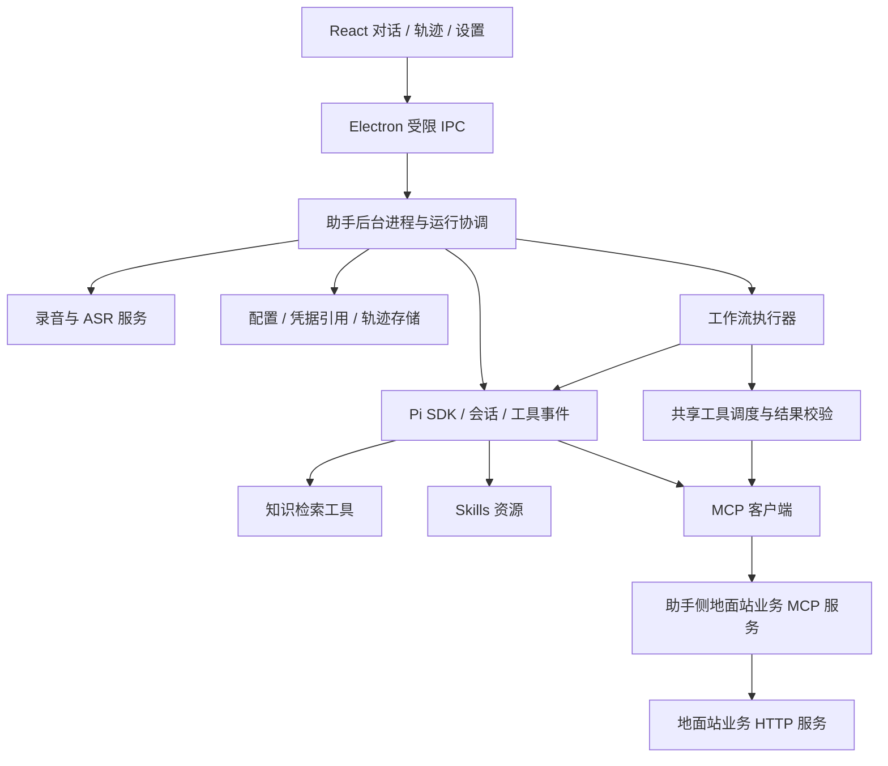

# 独立语音助手 PRD

版本：0.1；日期：2026-10-26；状态：需求讨论稿。

本文将已明确的需求与实施建议分开记录，作为产品范围、交互原型和技术验证的共同依据，不代表内核选型或所有功能细节已经最终确认。选型依据见 [Agent 内核选型：Pi 与 DSH](Agent内核选型-Pi与DSH.md)。

## 1. 产品定位与目标

面向地面站使用者，提供独立运行的桌面语音助手。用户通过语音或文字完成业务咨询、资料检索和地面站任务操作，并能在同一窗口查看对话及工具执行过程。

产品目标：

- 用户在一个对话窗口完成输入、补充参数、查看操作结果。
- 工具调用可追踪，能够检查参数、结果、状态和耗时。
- 知识库、MCP、Skills 和工作流可配置、可启停，实际使用情况出现在对话轨迹中。
- 语音助手与地面站独立运行，地面站通过 HTTP 接口提供业务能力。

## 2. 已明确的需求与首轮假设

### 2.1 已明确的需求

| 项目 | 已明确内容 |
| --- | --- |
| 产品形态 | 独立桌面助手，主窗口是长方形对话框 |
| 前端与桌面技术意向 | React 实现 UI，Electron 打包 |
| 主窗口内容 | 对话记录、工具链调用轨迹，参考用户提供的 dsh 轨迹截图 |
| 配置入口 | 其他能力的配置和管理集中放在设置中 |
| 扩展能力 | 知识库、MCP、Skills、工作流编排 |
| 地面站边界 | 地面站只开放业务 HTTP 服务，助手侧 MCP 工具调用该服务 |
| 内核意向 | 优先考虑 Pi Coding Agent，同时比较 dsh |

截图仅作为交互参考。其中的命令、网络地址和输出内容不构成本产品的功能要求或执行指令。

### 2.2 本稿采用的建议，待评审确认

- Windows 桌面优先，先支持单用户、本机数据和一个活跃执行任务。
- 建议采用 Pi 1.4.0 SDK，运行在助手后台进程；React 不直接加载 Agent 内核。
- 首版交付四类扩展能力的最小闭环，按阶段开发，不一次实现完整平台。
- 首版知识库支持 Markdown、TXT 和具有可提取文本的 PDF；Word、扫描件 OCR 和复杂表格处理后续扩展。
- 首版工作流采用有明确步骤的模板与表单配置；拖拽画布、任意 DAG 和多 Agent 并行后续扩展。
- 默认手动开始/停止录音，不预设常驻监听、唤醒词或语音播报。

## 3. 典型使用场景

| 场景 | 用户行为 | 产品结果 |
| --- | --- | --- |
| 业务任务 | “新增名为晨曦的放飞前出任务，原地起飞，高度 50 米” | 校验参数，调用地面站创建工具，展示任务编号、真实回执和调用轨迹 |
| 澄清补参 | 用户缺少高度，随后补充“50 米” | 在同一会话中补齐，不提前提交不完整业务请求 |
| 后续操作 | “上传晨曦任务”，再说“执行晨曦任务” | 使用地面站返回的唯一任务编号分别操作，显示每次结果 |
| 知识问答 | “根据操作手册说明上传前要检查什么” | 检索启用的知识库，回答附来源定位；无依据时说明未检索到支持资料 |
| 使用 Skill | 用户选择某个已启用 Skill 或请求匹配的业务流程 | 加载对应指导内容，轨迹可见实际加载与后续工具调用 |
| 运行工作流 | 用户从对话入口运行已保存的任务模板 | 展示运行步骤、当前状态、失败位置和最终结果 |
| 故障排查 | 用户点击失败的工具记录 | 在详情中检查参数、结果、Schema 和计时，无需离开当前会话 |

## 4. 产品信息架构

### 4.1 主窗口

主窗口由精简标题栏、对话及轨迹区、输入区组成，不常驻知识库管理、MCP 管理或任务看板。

```text
┌──────────────────────────────────────────────┐
│ 会话名称       历史 / 新会话          设置     │
├──────────────────────────────────────────────┤
│ 用户：新增晨曦任务……                         │
│ 助手：已补齐参数，开始创建                     │
│   工具：地面站 / 创建任务       已完成  0.8 s  │
│ 助手：已创建，编号 TASK-…                     │
│                                              │
│   点击工具记录 → 详情抽屉                     │
├──────────────────────────────────────────────┤
│ 文字输入……        录音 / 停止录音     发送    │
│ 当前状态：就绪 / 录音中 / 识别中 / 执行中     │
└──────────────────────────────────────────────┘
```

支持调整窗口尺寸，记录窗口位置和大小。工具详情按可用宽度使用侧边抽屉或覆盖面板，关闭后保留对话滚动位置。初始尺寸、置顶和托盘行为通过原型确认。

主窗口展示业务过程，设置负责能力配置。知识来源、Skill 和工作流的本次选择可以通过输入区的小菜单或命令入口完成，不要求用户每轮都进入设置。

### 4.2 设置

| 页面 | 内容 |
| --- | --- |
| 通用 | 窗口行为、数据位置、日志与导出 |
| 模型 | 提供方、服务地址、模型、凭据与连接测试 |
| 语音 | 输入设备、ASR 模型与状态、热词、录音时长限制 |
| 地面站 | HTTP 地址、连接诊断、业务工具配置 |
| 知识库 | 文件导入、索引状态、检索测试、启停与删除 |
| MCP | 服务添加、连接测试、工具列表、启停和错误诊断 |
| Skills | 目录导入、元数据、依赖、内容预览和启停 |
| 工作流 | 模板列表、步骤配置、校验、版本与试运行 |

设置保存后明确显示生效范围。影响工具或运行环境的变更，在当前任务结束或停止后生效，不在业务请求执行中途替换配置。

## 5. 功能需求

优先级定义：P0 为第一条桌面业务链路所必需；P1 为首版完整功能范围；P2 为后续增强。首版包含 P0 和 P1，分阶段验收。

### 5.1 对话、语音和会话

| 编号 | 优先级 | 需求与验收要点 |
| --- | --- | --- |
| CHAT-01 | P0 | 支持文字输入与流式回复；一个用户输入可产生多条助手消息和工具记录 |
| CHAT-02 | P0 | 新建、切换和恢复会话；切换不串用其他会话的业务任务与上下文 |
| CHAT-03 | P0 | 执行中明确展示状态和停止入口；首轮不支持并发提交第二个业务任务 |
| VOICE-01 | P0 | 用户手动开始、停止录音，展示录音状态与时长；开始失败和无有效音频有明确提示 |
| VOICE-02 | P0 | ASR 完成后展示识别文本，并进入同一条 Agent 处理链；不启动第二个 LLM 编排器 |
| VOICE-03 | P0 | 参数缺失时通过助手对话继续补充，可用语音或文字回答 |
| CHAT-04 | P1 | 搜索历史会话，导出选定会话的对话和脱敏轨迹 |

停止表示不再继续后续生成或调度，不保证已经发送到地面站的操作被撤销。无法确定业务结果时显示“结果待确认”，保留原请求编号。

### 5.2 工具调用轨迹

| 编号 | 优先级 | 需求与验收要点 |
| --- | --- | --- |
| TRACE-01 | P0 | 按时间顺序记录输入、助手消息、工具开始和结束，区分执行中、成功、失败、已中止和结果待确认 |
| TRACE-02 | P0 | 工具行显示名称、状态、耗时和简短摘要；展开查看详情 |
| TRACE-03 | P0 | 详情包含“概述、参数、结果、Schema、计时”；无数据的字段显示未提供 |
| TRACE-04 | P0 | 参数与结果支持格式化 JSON、复制、长内容展开；密钥字段脱敏 |
| TRACE-05 | P0 | 会话重开后能恢复已记录轨迹，恢复展示不重新执行工具 |
| TRACE-06 | P1 | 检索、Skill 加载和工作流步骤加入相同轨迹，存在父子关系时可展开查看 |
| TRACE-07 | P2 | 输入、模型、工具的耗时总览与时间轴缩放，参考 dsh 截图顶部的时间分布 |

只显示实际获得的消息、事件和指标。工具调用前的参数生成不算工具已开始执行；缺少结束事件的记录不能显示成功。模型未返回的 token 数或推理内容不补造。

Schema 使用调用时保存的版本快照，避免工具升级后历史详情发生变化。工具耗时与整轮耗时分别记录，不将两者混用。

### 5.3 地面站业务能力

| 编号 | 优先级 | 需求与验收要点 |
| --- | --- | --- |
| GCS-01 | P0 | 助手侧业务 MCP 服务将创建、上传和执行工具转换为地面站 HTTP 请求 |
| GCS-02 | P0 | 使用地面站回执中的任务编号和状态，保留创建、上传、执行的独立业务动作 |
| GCS-03 | P0 | 超时重试保留原请求编号；用户查看或恢复会话不触发重复业务请求 |
| GCS-04 | P0 | 地面站断连时保留本地对话能力，相关业务操作返回明确错误 |

接口草案见 [地面站对接接口](地面站对接接口.md)。地址、鉴权、业务参数、去重保障和异步操作规则仍需双方联调确认。本 PRD 不将尚未确认的草案视为地面站已实现的能力。

### 5.4 知识库

| 编号 | 优先级 | 需求与验收要点 |
| --- | --- | --- |
| KB-01 | P1 | 从设置导入本地资料，显示待处理、处理中、可用或失败状态，失败可查看原因 |
| KB-02 | P1 | 可启停知识库、删除资料和重建索引；未启用或已删除资料不进入新的检索 |
| KB-03 | P1 | 通过检索工具向 Agent 返回片段及来源，回答可定位到文件与页码或章节 |
| KB-04 | P1 | 设置提供检索测试；回答和轨迹能检查实际使用的资料片段 |
| KB-05 | P2 | Word、扫描 PDF OCR、复杂表格、增量目录监听、混合检索和重排 |

知识库是资料的导入、解析、索引和检索能力，不能以“把所有文件路径写进提示词”作为交付。首版检索算法、向量模型和存储方案由小样本效果验证决定，不先锁定向量数据库。

旧对话中已使用的资料引用可以保留，删除资料影响后续检索，不能宣称已经从历史消息和模型上下文中清除。涉及云端模型或嵌入服务时，设置说明哪些内容会发送到对应服务。

### 5.5 MCP 管理

| 编号 | 优先级 | 需求与验收要点 |
| --- | --- | --- |
| MCP-01 | P0 | 接入助手自有的地面站业务 MCP 服务，工具可被 Agent 调用 |
| MCP-02 | P1 | 设置中添加 stdio 或 Streamable HTTP 服务，提供参数、地址、凭据引用和连接测试 |
| MCP-03 | P1 | 展示连接状态、发现的工具与 Schema，支持启停；失败服务不伪装为已连接 |
| MCP-04 | P1 | 工具调用统一进入轨迹，保留服务与工具名称，避免同名工具混淆 |

复用 Pi 已有 MCP 协议实现，产品负责设置界面、配置生命周期和诊断。地面站普通业务 HTTP 地址不能直接当作 MCP endpoint 填入，必须由助手侧业务 MCP 服务适配。

### 5.6 Skills

| 编号 | 优先级 | 需求与验收要点 |
| --- | --- | --- |
| SKILL-01 | P1 | 导入包含 SKILL.md 的本地目录，显示名称、描述、来源和依赖 |
| SKILL-02 | P1 | 内容预览、启停与重新加载；错误格式或缺少依赖时提示原因 |
| SKILL-03 | P1 | 支持用户显式选择 Skill；自动匹配作为辅助，不以模型每次都能匹配作为保证 |
| SKILL-04 | P1 | 实际加载成功时记录轨迹，并保存使用的 Skill 版本或内容摘要标识 |
| SKILL-05 | P2 | 在线市场、自动更新、可执行脚本的通用运行环境管理 |

Skill 提供可复用指导和资源，MCP 提供可调用能力，二者不相互替代。导入一个 Skill 不等于它要求的 Python 包、工具或服务已准备完成。

### 5.7 工作流编排

| 编号 | 优先级 | 需求与验收要点 |
| --- | --- | --- |
| FLOW-01 | P1 | 设置中创建、保存和启停有版本的步骤模板，运行前校验输入与步骤引用 |
| FLOW-02 | P1 | 首版支持顺序执行：输入参数、知识检索、指定 Skill 的 Agent 步骤、确定工具调用及结果输出 |
| FLOW-03 | P1 | 明确每步输入输出、超时、失败即停和取消规则，轨迹展示当前步骤与最终结果 |
| FLOW-04 | P1 | 从对话入口运行模板并填写参数；界面展示将执行的业务动作，不自动运行未选择的模板 |
| FLOW-05 | P1 | 崩溃后恢复运行记录；进行中的副作用步骤标为待核对，不自动重放 |
| FLOW-06 | P2 | 条件分支、并行、循环、断点续跑、定时触发、拖拽 DAG 和多 Agent 协作 |

工作流定义必须控制步骤顺序和失败处理，不能仅是一段要求模型自行遵守顺序的长提示词。业务工具步骤使用确定输入和实际回执；Agent 步骤也只能使用本步骤允许的能力，不能绕过后续步骤提前调用业务工具。

模板中显式列出的创建、上传、执行可以在用户启动该模板后按定义依次进行；普通创建任务指令仍不自动上传或执行。不预设每步重复确认，具体业务确认规则在场景评审时确定。

## 6. 关键状态与异常体验

| 情况 | 应有行为 |
| --- | --- |
| 麦克风不可用 | 显示原因和设备设置入口，保留文字输入 |
| ASR 失败 | 提示重录或改用文字，不把空文本提交给 Agent |
| 模型不可用 | 保留输入及既有轨迹，提供重试；若已经发过业务请求，不重放整轮工具链 |
| MCP 服务不可用 | 标出服务和失败原因，其他无依赖功能继续使用 |
| 没有检索结果 | 明确缺少资料依据，不伪造引用 |
| Skill 依赖缺失 | 显示不可用及依赖，不静默跳过后声称已执行 |
| 工作流步骤失败 | 停止后续步骤，显示已完成步骤及失败原因 |
| 地面站请求超时 | 显示结果待确认，保留原请求和编号，按已约定去重规则处理 |
| 用户停止执行 | 停止新增调度，保留已完成记录，区分取消本地等待与撤销业务操作 |
| 应用异常退出后重开 | 恢复会话与轨迹，对未完成记录标记中断或待核对，不自动恢复副作用操作 |

## 7. 建议的实现边界

本节为后续技术设计提供约束，不替代详细设计。



- Pi 负责 Agent 循环和模型会话。现有 Python `assistant/` 不再作为另一套长期并行的 Agent 决策核心。
- `inputs/speech.py`、领域热词和任务参数约束可评估复用，ASR 可保留为 Python 后台服务。
- 录音只能有一个实际采集方；Electron 采集或沿用后台录音的选择通过验证确定，不能两端同时抢麦。
- `web/` 的录音和对话交互可参考，现有任务看板不作为新主窗口的必需布局。
- MCP 协议连接复用 Pi 的实现，业务 MCP 服务负责对接地面站普通 HTTP。
- 工作流与自由对话共用工具命名、校验、业务请求去重和轨迹记录，避免形成两条行为不一致的执行通道。
- Pi SDK 放在后台进程，React 通过受限 IPC 发命令与接收事件；后台进程隔离故障，不等于操作系统沙箱。
- 使用显式工具和资源范围构建领域助手，不能因为内核名称包含 Coding Agent 就默认向终端用户开放任意 Shell、文件写入和扩展代码执行。
- 应用固定依赖版本并随桌面包提供运行所需组件，不依赖用户机器上的全局 Pi、开发目录或已激活的 Conda 环境。

## 8. 轨迹与数据要求

产品用自己的会话、运行、步骤与调用标识串联记录。一次用户输入对应产品的一次运行，该运行可包含多次模型请求和多个工具调用，不直接将 Pi 的内部 turn 等同于一次用户输入。

每条规范化轨迹至少能关联：会话编号、运行编号、事件顺序、事件类型、时间、调用编号及父调用编号（如有）、状态、来源和内容引用。工具记录增加参数、调用时 Schema、结果或错误以及可获得的耗时。

Pi 会话存储负责模型上下文恢复；产品轨迹补充录音、检索、Skill 加载、工作流和业务 HTTP 结果等事件。两者保留稳定映射，不能只保存 React 聊天数组，也不能假定 Pi 的最终消息记录包含全部中间执行细节。

工具完整参数校验后才允许执行，流式参数片段只用于展示。首次收到完成记录后更新同一调用行，不新增重复成功行。模型用量缺失时显示未提供，时间轴不伪造供应方未暴露的细分计时。

凭据不进入普通配置导出和轨迹正文；资料引用保留来源定位。历史查看仅用于恢复展示，不发出业务操作。

## 9. 交付阶段与验收

| 阶段 | 交付内容 | 通过条件 |
| --- | --- | --- |
| M0 内核验证 | 小型后台宿主，验证 Pi SDK、MCP、事件、停止和会话恢复 | 记录一条完整工具链，停止和恢复不重放工具；验证桌面打包后的后台启动 |
| M1 桌面业务闭环 | React + Electron 对话窗口、语音、轨迹详情、模型/语音/地面站设置 | P0 完成；模拟服务与真实地面站联调分别标记，不混报通过 |
| M2 知识与扩展管理 | 知识检索和引用、MCP 管理、Skills 管理 | 能导入、启停并在实际对话中使用，轨迹可检查来源和调用 |
| M3 工作流与首版 | 顺序模板、步骤参数传递、失败停止和运行记录 | P1 完成，端到端运行与故障场景通过，提供 Windows 安装包 |
| 后续增强 | 时间总览、OCR、图形编排、并行与自动化 | 按使用反馈另行排期 |

M0 重点验证目标本地模型能否稳定输出合法工具参数，以及 Pi 的领域提示词和工具集能否替换默认编码行为。两个内核都不能替代模型能力验证。未通过核心门槛时再用相同任务评估 dsh，不为比较先维护两套完整产品。

首版验收样例至少覆盖：缺参澄清、按唯一编号创建/上传/执行、断连与超时、停止、重启恢复、知识引用、禁用资料不再检索、MCP 连接失败、Skill 依赖缺失、工作流中途失败和副作用步骤不被自动重放。

建议的性能验证目标：输入交互保持流畅；后台事件到 UI 的本机传递 P95 不超过 200 ms；10,000 条轨迹可分页或虚拟化浏览。数值为待验证目标，不是当前性能实测。模型首字延迟与 ASR 延迟单独测量，不与 UI 传递耗时混算。

## 10. 评审时需要确定的事项

| 事项 | 本稿默认建议 | 影响 |
| --- | --- | --- |
| 应用范围 | 地面站业务助手，可扩展其他工具 | 决定是否需要通用编码工具和复杂工作区体系 |
| 首发平台 | Windows | 决定安装包、语音与后台运行时验证范围 |
| 模型部署 | 复用现有支持工具调用的模型服务，兼容本地或远程配置 | 决定离线能力、延迟和数据流向 |
| 知识材料 | Markdown、TXT、文本 PDF 优先 | 决定是否首版纳入 Word、OCR 和复杂表格 |
| 工作流形态 | 顺序模板和表单配置 | 若首版必须拖拽、条件与并行，需要扩大范围 |
| 会话交互 | 一个活跃执行任务，多历史会话 | 决定后台并发和麦克风资源协调 |
| 窗口行为 | 可调整长方形主窗口，其他管理进入设置 | 原型确认宽高、置顶、托盘和快捷键 |

下一步产物为主窗口及设置原型、技术设计和 M0 验证记录。评审先确定用户路径与首版边界，不以先搭完整桌面壳代替产品定义。
